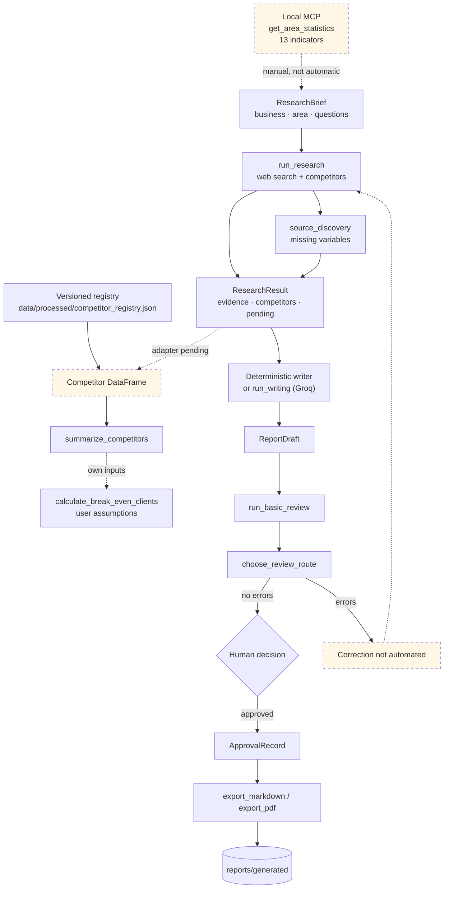
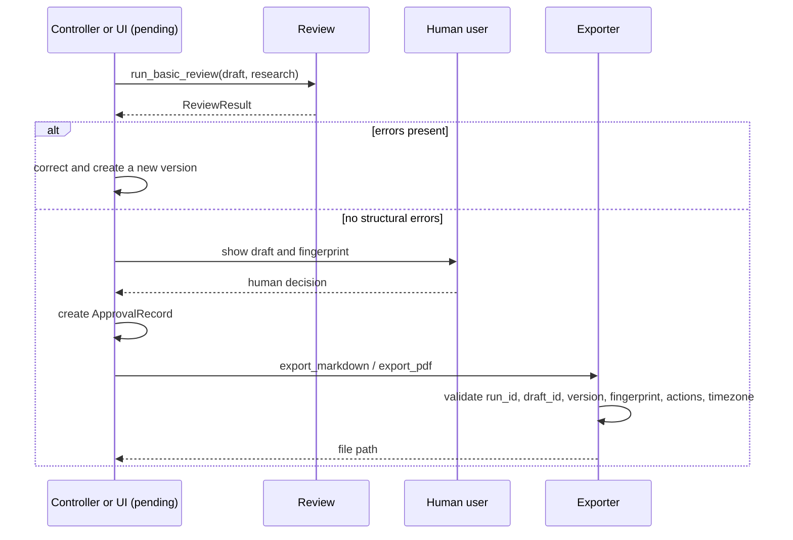

<p align="center">
  <a href="README.md">Versión en español</a>
  ·
  <a href="#current-status">Estado</a>
  ·
  <a href="#offline-demo">Demo</a>
  ·
  <a href="#setup">Setup</a>
  ·
  <a href="#documentation">Documentación</a>
</p>

<p align="center">
  
</p>

<p align="center">
  
</p>

<h1 align="center" style="margin-top:6px; font-family:system-ui,sans-serif; font-weight:800; letter-spacing:-1px;">FitFamily</h1>
<p align="center" style="color:#172B2A; font-size:15px; font-weight:500;">
  Investigación de mercado y generación de informes trazables para un gimnasio con ludoteca en <strong>El Cañaveral, Madrid</strong><br>
  <sub>Proyecto abierto · Flujo automático con persistencia SQLite · Contrato de cálculo estructurado · Actualizado oct 2026</sub>
</p>

<p align="center">
  <a href="README.md">Versión en español</a>
  ·
  <a href="#current-status">Status</a>
  ·
  <a href="#offline-demo">Demo</a>
  ·
  <a href="#setup">Setup</a>
  ·
  <a href="#documentation">Documentation</a>
</p>

<p align="center">
  
  
  
  
  
  
</p>

> [!NOTE]
> Este proyecto integra investigación trazable, análisis económico (`calculation-review-contract.md`), revisión numérica (`numeric_validation.py`) y flujo automático (`workflows.py`) con persistencia SQLite. La interfaz web (`streamlit`) sigue pendiente como paso final.

## Qué es FitFamily

FitFamily recibe un encargo de investigación (`ResearchBrief`), recopila evidencias de fuentes web y de datos municipales oficiales, estructura competidores y produce un borrador de informe. Después puede revisarse la estructura del borrador, registrar una decisión humana y exportarlo a Markdown o PDF.

The project starts from a concrete problem: opening a gym with a playroom in a young Madrid neighbourhood requires combining population, households, premises, licences, sports supply, prices, and financial assumptions. Those data are scattered, belong to different periods, and are sometimes unavailable. FitFamily makes explicit **what was observed, what was derived, what is an assumption, and what is missing**.

| Question | Current answer |
|---|---|
| Does it research competitors on the web? | Yes, through `run_research`; it needs network access and does not use an LLM for collection. |
| Does it expose municipal data? | Yes, a local MCP server with 13 indicators; 11 verified and 2 unavailable. |
| Does it analyse prices and playrooms? | Only with available data: the committed registry has no prices and no confirmed playrooms. |
| Does it write a report? | Yes, with a deterministic writer or an optional LLM (Groq). |
| Does it review the report? | Yes, references and structural quality; it does not verify semantic truth. |
| Does it export? | Yes, Markdown and PDF, only after a valid `ApprovalRecord`. |
| Does it have a UI? | **No.** `src/ui/` is empty; there is no Streamlit app and there are no UI screenshots. |
| Does it have a fully automated flow? | **Partial.** `workflows.py` connects analysis → writing → review; UI and full controller still missing. |

## The problem it addresses

A location decision usually fails for one of these reasons:

1. **Data without context.** A population figure without a date, scope, or source cannot support a comparison or a ratio.
2. **Missing data that gets filled in.** An unknown price is not zero; an unconfirmed playroom does not mean “no playroom”; “families with children” is not an official census category.
3. **Mixed reference periods.** October 2026 population must not be divided by January 2025 households.
4. **Lost traceability.** A polished report without links, snippets, and limitations cannot be audited.
5. **Diffuse approval.** Generating text is not the same as authorising its publication.

FitFamily applies four rules:

- **Evidence before prose.** Every data point should be traceable to a source, a date, and, where applicable, a snippet.
- **Explicit contracts.** Modules exchange validated models (`ResearchBrief`, `ResearchResult`, `ReportDraft`, `ReviewResult`, `ApprovalRecord`).
- **`null` means “unavailable”.** It is never converted into zero, an average, or a silent guess.
- **Human approval.** The exporter checks an approval record; the writer and automated review do not grant approval.

## Current status

Nothing is presented as finished when it is not. This is the real classification after reviewing the code, tests, and committed data on **26 October 2026**.

| Status | What it includes |
|---|---|
| **Implemented and covered by tests** | Pydantic contracts; search, page-reading, competitor and source-discovery tools; official registry; local MCP; descriptive analysis and break-even; deterministic writer; Markdown/PDF rendering; approval-gated export; structural review and correction routes. |
| **Implemented but isolated or conditional** | Web research (needs network); competitor registry (a versioned snapshot with no prices or confirmed playrooms); LLM route (needs Groq and has only been tested with mocks); MCP (a separate local tool, not automatically connected to research); `coverage_percentage` (always `0.0`). |
| **Designed, not implemented** | Streamlit; LangGraph; approval controller; scheduled data refresh; tracking CSV; authentication; deployment; audit trails. |
| **Out of current scope** | Investment recommendation, full financial model, income-based demand study, viability guarantee, multi-user application. |

In practice, the end-to-end path **is composed by calling functions**, not by running an application:

```text
ResearchBrief → run_research → ResearchResult → build_report → ReportDraft
             → run_basic_review → ApprovalRecord → export_markdown/export_pdf
```

Research is not automatically connected to analysis: moving from `ResearchResult` to a `DataFrame` requires an explicit adapter or the committed registry at `data/processed/competitor_registry.json`. MCP is not called automatically by `run_research`; it is an independent local tool.

## Who builds it

The project has **five human development roles**, not five agents running in production. The components under `src/agents/` are code; the people design and maintain them.

| Person | Role | Main contribution | Document |
|---|---|---|---|
| **Juan** | Research, data, and MCP | Shared schemas, web tools, official registry, MCP server/client, source audit | [docs/research-module.md](docs/research-module.md) · [docs/auditoria-fuentes-datos.md](docs/auditoria-fuentes-datos.md) |
| **Laura** | Analysis and scenarios | `summarize_competitors`, playroom normalisation, break-even | [docs/analysis.md](docs/analysis.md) |
| **Gema** | Writing, reports, and export | Deterministic writer, LLM writer, rendering, approval-gated export | [docs/report-export.md](docs/report-export.md) · [docs/writer-llm.md](docs/writer-llm.md) |
| **María** | Review and quality | Reference validation, evidence quality, correction routes | [docs/review-quality.md](docs/review-quality.md) |
| **Isabella** | UI and orchestration | Streamlit, LangGraph, and human-approval design; implementation pending | [docs/streamlit-approval.md](docs/streamlit-approval.md) · [docs/langgraph-flow.md](docs/langgraph-flow.md) |

The only route that executes a CrewAI `Crew` is the LLM writer. `build_researcher()` and `build_research_task()` create CrewAI objects, but `run_research()` uses the Python tools directly so collection stays deterministic and does not depend on a model key.

## Use case: El Cañaveral

The scope is **El Cañaveral**, a neighbourhood in the Vicálvaro district of Madrid. The underlying question is not merely “are there gyms?” but:

- How many people live there, and how many are children or young people?
- How many households are there, and how many may need childcare?
- What sports, children’s leisure, and pool supply exists?
- What prices and services do competitors publish?
- Which parts of the decision still depend on data we do not have?

### What the published data says

| Indicator | Value | Reference | Nature |
|---|---:|---|---|
| Total population | 27,480 | 1 Oct 2026 | Observed: Municipal Register, sum of ages |
| Population under 20 | 28.29% | 1 Oct 2026 | Derived: 7,774 / 27,480 |
| Total population at 1 Jan 2025 | 21,492 | 1 Jan 2025 | Observed: official household file |
| Households | 8,140 | 1 Jan 2025 | Observed: exact sum of 9 census sections |
| Average household size | 2.64 people/household | 1 Jan 2025 | Derived: 21,492 / 8,140 |
| Households with minors | 3,071 | 1 Jan 2025 | Verifiable minimum |
| Open premises | 234 | downloaded 20 Oct 2026 | Observed: Premises Census |
| Registered gyms | 9 | downloaded 20 Oct 2026 | Observed: activity code 931008 |
| Sports and recreation | 4 | downloaded 20 Oct 2026 | Observed: code 855002 |
| Children’s leisure | 3 | downloaded 20 Oct 2026 | Observed: codes 932001 and 932002 |
| Community pools | 3 | downloaded 20 Oct 2026 | Observed: code 931010 |
| Families with children | `null` | — | Unavailable: not an official neighbourhood category |
| Gyms with a playroom | `null` | — | Unavailable: no code combines both activities |

**Do not mix these periods.** October 2026 population and January 2025 households are different references. For household ratios, use `population_total_2025` or the already calculated average household size; do not divide 2026 population by 2025 households.

### What the competitor registry adds

`data/processed/competitor_registry.json` is a snapshot generated on **21 October 2026** from the Municipal Premises and Activities Census:

- **18 premises** with activity relevant to the study.
- **16** with licence information; a missing licence means “no information”, never “denied”.
- **14 of 18** with usable coordinates.
- **0 known prices** and **0 confirmed playrooms** in the committed artefact.
- Gym, sports, children’s leisure, and pool categories **overlap**: do not add 9 + 4 + 3 + 3 and call it 19 distinct premises.

A registered premises is not necessarily an operating business, and an administrative licence does not prove that the establishment is open. There is also no census of “gyms with a playroom”: that variable must be confirmed site by site.

### What has not been calculated

- **Average net household income by census section** has not been downloaded or imputed; it is documented as a pending phase in [docs/pendiente-renta-ine.md](docs/pendiente-renta-ine.md).
- There is no demand model, revenue forecast, or investment recommendation.
- Break-even is a mathematical function: its costs and fees are **user assumptions**, not observed data.

## How it works



**Legend:** solid arrows are available calls; dotted arrows are manual or pending steps. MCP, the `ResearchResult → DataFrame` adapter, automatic correction, and the UI are not part of a runnable pipeline.

1. **Research.** `run_research(brief, context=None)` searches the web, reads pages, searches competitors, and, when the brief declares `missing_variables`, runs a source-discovery pass. It returns a `ResearchResult` with evidence, competitors, and unresolved questions. It does not use an LLM.
2. **Analysis.** `summarize_competitors(data)` describes the market from a `DataFrame`; `calculate_break_even_clients(...)` calculates minimum clients with explicit assumptions. The official registry can be converted with `to_dataframe`.
3. **Writing.** `build_report(brief, research_result)` uses the deterministic writer; `build_report(..., use_llm=True)` uses CrewAI + Groq. Both return a `ReportDraft` and validate that cited references exist.
4. **Review.** `run_basic_review(draft, research_result)` checks references and structural quality; `choose_review_route(...)` decides whether to send the draft back to research, analysis, or writing, or forward it to human review.
5. **Approval and export.** A person decides. The controller creates an `ApprovalRecord`; `export_markdown` or `export_pdf` validate the run, draft, version, fingerprint, action, and timezone before publishing.

See [docs/arquitectura-modulos.md](docs/arquitectura-modulos.md) for the detailed component map and boundaries.

## Data contracts

Contracts are the most important part of the project because they let modules be tested separately without inventing data.

| Contract | What it represents | Key fields |
|---|---|---|
| `ResearchBrief` | The research brief | `business_type`, `location`, `study_area`, `questions`, `search_limits`, `missing_variables`, `assumed`, `assumed_params` |
| `Evidence` | A claim with provenance | `evidence_id`, `claim`, `value`, `unit`, `frequency`, `source_url`, `snippet`, `date_observed`, `geo_scope`, `limitations` |
| `Competitor` | A competitor | `identifier`, `name`, `location`, `services`, `tariffs`, `evidences`, coordinates, census section, licence, `has_playroom` |
| `ResearchResult` | The research outcome | `evidences`, `competitors`, `coverage_percentage`, `unresolved_questions`, `search_performed`, `notes` |
| `ReportDraft` | The report draft | `title`, `study_area`, `sections`, `sources`, `limitations`, `draft_id`, `version`, `claims` |
| `ReviewResult` | Structural diagnosis | `draft_id`, `draft_version`, `draft_fingerprint`, `issues`, `checks_performed` |
| `ApprovalRecord` | Human decision | `run_id`, `draft_id`, `draft_version`, `draft_fingerprint`, `approved`, `actions`, `decided_at` |

Invariants to remember:

- `null` or `[]` means **unavailable**, not zero.
- `ResearchResult.evidences` should include the evidence attached to competitors; if both lists are iterated, they must be deduplicated.
- `coverage_percentage` exists in the contract, but the current implementation leaves it at `0.0`.
- `ReportDraft` receives a new `draft_id` and `version=1`; the version must be incremented manually when content changes.
- `ReviewResult` is never approval.
- `ApprovalRecord.decided_at` must include a timezone.

## Offline demo

The first step needs no keys or Internet: check the local MCP server.

```bash
python -m src.mcp.client
```

The client starts the server over `stdio`, discovers one tool (`get_area_statistics`), and queries two indicators. Exact console output may differ in accents depending on the terminal.

### Versioned registry → analysis → draft → review

This example uses the real `data/processed/competitor_registry.json` artefact; it does not access the web.

```python
import json
from pathlib import Path

from src.analysis.market_analysis import summarize_competitors
from src.reporting.report_builder import build_report
from src.review.quality_checks import run_basic_review
from src.schemas import Competitor, ResearchBrief, ResearchResult
from src.tools.competitor_registry import to_dataframe

artifact = Path("data/processed/competitor_registry.json")
raw = json.loads(artifact.read_text(encoding="utf-8"))
competitors = [Competitor(**item) for item in raw["competitors"]]

brief = ResearchBrief(
    business_type="gym with a playroom",
    location="Madrid",
    study_area="El Cañaveral",
    questions=["Which competitors are there?", "Is there a playroom?"],
    missing_variables=["average net household income"],
)

research = ResearchResult(
    evidences=[ev for c in competitors for ev in c.evidences],
    competitors=competitors,
    unresolved_questions=["Confirm playroom and prices for each premises."],
    search_performed="Versioned Municipal Premises Census; no network.",
)

print(summarize_competitors(to_dataframe(competitors)))
draft = build_report(brief, research)
review = run_basic_review(draft, research)
print(review.status, len(review.issues))
```

With the current artefact, the summary returns **18 competitors, 0 known prices, and 18 unknown playroom values**. The deterministic writer creates no fee claims because there are no prices with a source, amount, unit, and frequency. Review is `pending_review`: there are no structural errors, but that is **not** approval.

### Approval-gated export

Continuing from the previous block (it uses the same `draft`):

```python
from datetime import datetime, timezone

from src.automation.exporter import (
    calculate_draft_fingerprint,
    export_markdown,
    export_pdf,
)
from src.automation.models import ApprovalRecord

approval = ApprovalRecord(
    run_id="demo-2026-10-26",
    draft_id=draft.draft_id,
    draft_version=draft.version,
    draft_fingerprint=calculate_draft_fingerprint(draft),
    approved=True,
    actions=("export_markdown", "export_pdf"),
    decided_at=datetime.now(timezone.utc),
)

markdown_path = export_markdown(
    draft, approval, run_id=approval.run_id, output_dir="reports/generated"
)
pdf_path = export_pdf(
    draft, approval, run_id=approval.run_id, output_dir="reports/generated"
)
print(markdown_path)
print(pdf_path)
```

`export_markdown` and `export_pdf` write to `reports/generated` and do not overwrite a different export. If you only want to inspect the draft, stop before this part: `build_report` and `run_basic_review` do not write files.

## Optional web research

Real sources require network access. Without `TAVILY_API_KEY`, search uses DuckDuckGo through `ddgs`.

```python
from src.agents.researcher import run_research
from src.schemas import ResearchBrief

brief = ResearchBrief(
    business_type="gym with a playroom",
    location="Madrid",
    study_area="El Cañaveral",
    questions=["Which gyms are there?", "What prices do they publish?"],
    search_limits={"max_results": 5},  # 1-20; default 5
    missing_variables=["average net household income"],
)

result = run_research(brief)
print(len(result.competitors), len(result.evidences))
print(result.coverage_percentage)  # 0.0: coverage is not calculated
```

`run_research` does not raise when a provider fails: it returns a partial result with the error in `search_performed` and no invented data. An invalid brief raises `ValueError`.

Page reading includes SSRF protections: it rejects non-HTTP(S) schemes, credentials in URLs, private or internal hosts, redirects to disallowed destinations, and IPv4 addresses mapped into IPv6. It does not execute scripts or follow instructions found on a page.

## Optional LLM writing

The LLM route uses CrewAI with Groq. It needs:

```bash
# macOS / Linux
export GROQ_API_KEY="your_key"
export WRITER_LLM_MODEL="groq/openai/gpt-oss-120b"

# Windows PowerShell
$env:GROQ_API_KEY = "your_key"
$env:WRITER_LLM_MODEL = "groq/openai/gpt-oss-120b"
```

The project loads `.env` from the repository root if present. Never store real keys in the repository; [`.env.example`](.env.example) only lists the variable names.

```python
from src.reporting.report_builder import build_report

draft = build_report(brief, research, use_llm=True)
```

`use_llm=True` runs `run_writing`, which makes a real provider call and consumes quota. There is no automatic fallback to the deterministic writer. If the LLM returns an invalid structure, an empty section, a fact without references, or a nonexistent reference, the route fails.

**Verification status:** `run_writing` tests use simulated responses. This review did not execute a real Groq call or evaluate a real model’s quality. The LLM route is not part of CI with a provider.

## Review and approval

Current review is structural, not semantic. It checks:

- references to evidence that does not exist;
- facts without `evidence_ids`;
- duplicate claim identifiers;
- empty references;
- evidence supporting facts without `source_url`;
- failed-access evidence (`access_attempt_*`) used as proof;
- rejected sources (`source_* [rejected]`) used as support.

`run_basic_review` assigns `severity="error"` to everything it detects and returns `needs_revision` or `pending_review`. `choose_review_route` decides the correction stage and blocks after `max_revisions=2` by default. It does not correct the draft, call an LLM, or export.



Creating an `ApprovalRecord` in Python does not prove that a person approved anything. The controller must guarantee the provenance of the decision. That controller and a UI do not exist today.

## Setup

### Requirements

- Python **3.13** (the version used in CI).
- Git.
- Network only for web research, data extraction, or Groq calls.
- Dependencies are installed from `requirements.txt`.

### Installation

```bash
git clone https://github.com/Isabela-Tellez/FitFamily.git
cd FitFamily
python -m venv .venv
```

Windows PowerShell:

```powershell
.\.venv\Scripts\Activate.ps1
python -m pip install --upgrade pip
python -m pip install -r requirements.txt
```

macOS / Linux:

```bash
source .venv/bin/activate
python -m pip install --upgrade pip
python -m pip install -r requirements.txt
```

The repository is not installed as a package: `pyproject.toml` only configures pytest (`testpaths` and `pythonpath`). Run commands from the repository root.

### Environment variables

No variable is required for the offline demo, MCP, tests, or export.

| Variable | Purpose |
|---|---|
| `GROQ_API_KEY` | LLM writing (`use_llm=True` / `run_writing`) |
| `WRITER_LLM_MODEL` | Groq model; it must start with `groq/`; the example uses `groq/openai/gpt-oss-120b` |
| `TAVILY_API_KEY` | Alternative web search; without it, DuckDuckGo (`ddgs`) is used |
| `LANGCHAIN_TRACING_V2`, `LANGCHAIN_PROJECT`, `LANGSMITH_API_KEY` | Optional LangSmith traces |

[`.env.example`](.env.example) documents the names. Do not commit a `.env` with keys.

### Quick checks

```bash
python -m pytest -q
python -m compileall -q src tests data/raw
python -m src.mcp.client
```

### Optional data extraction

Scripts under `data/raw/` regenerate official data and are not part of startup:

```bash
python data/raw/extract_censo_locales.py
python data/raw/extract_households.py --verify-geometry
python data/raw/extract_competitor_registry.py --no-web
```

They require network access and, for households/cartography, offline dependencies that are **not** in `requirements.txt`: `openpyxl`, `pyogrio`, `geopandas`, and `shapely` (in addition to `pyproj`, which is pinned). Read [data/raw/README.md](data/raw/README.md) before running them.

## Data and method

### Sources and periods

| Source | Use | Period | Licence |
|---|---|---|---|
| Municipal Register (datos.madrid.es/200076-0-padron) | Population by age and sex | 1 Oct 2026; file updated 6 Oct 2026 | CC BY 4.0 |
| Households by size and census section (300438) | Households, average size, 2025 population, composition | 1 Jan 2025 | CC BY 4.0 |
| Census-section cartography (Geoportal) | Section → neighbourhood attribution and geometric verification | data 31 Aug 2026; sections from 2022 | CC BY 4.0 |
| Premises and Activities Census (200085) | Premises, activities, licences | downloaded 20 Oct 2026; daily updates | CC BY 4.0 |
| Competitor websites | Prices, services, playroom mentions | varies by visit | Each site’s terms |
| INE ADRH (30325) | Income by census section | **not downloaded** | Pending |

Full detail is in [docs/auditoria-fuentes-datos.md](docs/auditoria-fuentes-datos.md), [data/sources.json](data/sources.json), and [data/raw/README.md](data/raw/README.md).

### What each kind of data means

| Kind | Example | Treatment |
|---|---|---|
| **Observed** | 234 open premises; 9 registered gyms | Copied from the source with date and URL |
| **Derived** | 28.29% under 20; 2.64 people/household | Calculated with a documented formula |
| **Verifiable minimum** | 3,071 households with minors | Only explicit categories are counted; ambiguous categories are excluded |
| **Assumption** | Break-even fixed costs and fee | Entered by the user; never presented as observed |
| **Unavailable** | Income; families with children; gyms with a playroom | `null`; never imputed or converted to zero |

### Household aggregation

Official cartography assigns **9 census sections** to El Cañaveral (`COD_BAR = 194`): 19052, 19053, 19054, 19055, 19056, 19058, 19059, 19060, and 19061. The geometric audit verified that these sections tile the neighbourhood 100%, with no outside area and no uncovered area. Therefore the household sum is **exact**, not a proportional allocation. The independent check is 21,492 inhabitants at 1 January 2025.

### Refresh and limits

- MCP contains a documented **snapshot**; it is not a real-time API.
- `refresh_locales_count`, `refresh_gyms_count`, `refresh_households`, and `refresh_households_with_minors` download and update on demand, but there is no scheduler.
- The committed competitor registry is not refreshed on every run.
- Municipal data can contain administrative inconsistencies; a licence does not prove that a business is open.
- Income has not been downloaded or imputed. No demand model has been built.

## Tests and CI

The current suite has **273 tests in 28 files**. The local review on 26 October 2026 produced:

```text
273 passed, 36 warnings in 26.10s
```

The warnings are CrewAI deprecation notices, not failures. `python -m compileall -q src tests data/raw` exited with code 0. GitHub Actions CI runs on Ubuntu with Python 3.13:

```text
python -m compileall -q src tests data/raw
python -m pytest -q
```

The workflow runs on `push`/`pull_request` to `dev` and `main`, and on manual dispatch. It does not run linting, type checking, a coverage threshold, link checking, or tests against real providers.

Coverage includes: contracts, research with simulated responses, SSRF protections, data registry and parsing, MCP through a subprocess, analysis, scenarios, writers, reports, PDF, export, review, and routes. It **does not cover** a real search, a real Groq call, Streamlit, LangGraph, semantic verification, or the full flow with human approval.

See [docs/calidad-pruebas.md](docs/calidad-pruebas.md) for details.

## Limitations

1. **There is no single application.** There is no `main.py`, CLI, Streamlit app, or runnable graph. The flow is composed by calling APIs.
2. **Research and analysis are separate.** `ResearchResult` is not automatically converted into the `DataFrame` expected by `summarize_competitors`.
3. **MCP is not a live source.** It is a local store; refresh functions are not scheduled.
4. **Coverage is not calculated.** `coverage_percentage` stays at `0.0`; all brief questions also remain in `unresolved_questions`.
5. **The current registry has no prices or confirmed playrooms.** The 18 records cannot support an average price or a claim that a gym has a playroom.
6. **Review does not verify semantic truth.** It checks that references exist and facts have some reference; it does not prove that the source supports the sentence.
7. **The LLM route has not been validated with a real provider.** There are only mocked tests; quality, latency, cost, and prompt-injection resistance have not been measured.
8. **Human approval has no UI.** `ApprovalRecord` is a programmatic object; the controller that creates it is responsible for proving that a decision occurred.
9. **Export requires hard links.** The filesystem must support them; temporary-file cleanup after an abrupt shutdown is not guaranteed.
10. **There is no authentication, authorisation, database, audit trail, or deployment.** This is not a multi-user product.
11. **There is no demand model or investment recommendation.** Break-even only answers the arithmetic of the assumptions it receives.
12. **There are no UI screenshots.** `assets/` contains only the logo; presenting a screen that does not exist would be misleading.

## Roadmap

Priorities have no dates and should not be read as delivery commitments.

| Priority | Goal | Real prerequisite |
|---|---|---|
| 1 | `ResearchResult → DataFrame` adapter and connected analysis | Define which columns are propagated and how evidence is deduplicated |
| 2 | Review/approval controller and UI | Build the screen and create `ApprovalRecord` only after the decision |
| 3 | LangGraph orchestration with a correction limit | Add the dependency and define shared state |
| 4 | Integrate MCP into the flow | Decide whether research consumes local indicators and with what priority |
| 5 | Scheduled refresh and data traceability | Extraction, validation, and snapshot publication job |
| 6 | Semantic verification and LLM evaluation | Metrics, evaluation sources, and token budget |
| 7 | Income and demand model | Download ADRH, document the census section, and do not impute gaps |
| 8 | More neighbourhoods and deployment | Parameterise sources, add authentication, and add observability |

None of these pieces is presented as finished in this README.

## Repository structure

```text
FitFamily/
├── assets/                 # logo; no UI screenshots
├── data/
│   ├── processed/          # competitor registry JSON/CSV
│   ├── raw/                # extraction scripts and documentation
│   └── sources.json
├── docs/                   # architecture, research, analysis, reports, quality...
├── reports/                # output directories (empty in the repository)
├── src/
│   ├── agents/             # research and writing
│   ├── analysis/           # descriptive analysis and scenarios
│   ├── automation/         # approval and export
│   ├── graph/              # review routes (not a LangGraph graph)
│   ├── mcp/                # MCP server and client
│   ├── reporting/          # models, building, and rendering
│   ├── review/             # validation and quality
│   ├── tools/              # search, reading, competitors, sources
│   ├── ui/                 # reserved; only .gitkeep
│   ├── runtime/            # reserved; only .gitkeep
│   ├── security/           # reserved; only .gitkeep
│   ├── multimodal/         # reserved; only .gitkeep
│   └── schemas.py          # shared contracts
├── tests/                  # 28 files, 273 tests
├── .github/workflows/ci.yml
├── requirements.txt
└── pyproject.toml          # pytest configuration, not packaging
```

## Documentation

| Document | Purpose |
|---|---|
| [docs/arquitectura-modulos.md](docs/arquitectura-modulos.md) | Component map, contracts, and real boundaries |
| [docs/equipo.md](docs/equipo.md) | The five human roles and responsibilities |
| [docs/research-module.md](docs/research-module.md) | Web research, tools, MCP, and data |
| [docs/analysis.md](docs/analysis.md) | Descriptive analysis and break-even |
| [docs/report-export.md](docs/report-export.md) | Drafts, approval, and Markdown/PDF export |
| [docs/writer-llm.md](docs/writer-llm.md) | CrewAI + Groq route and its limits |
| [docs/review-quality.md](docs/review-quality.md) | Structural validation and correction routes |
| [docs/calidad-pruebas.md](docs/calidad-pruebas.md) | Tests, CI, and actual coverage (new) |
| [docs/streamlit-approval.md](docs/streamlit-approval.md) | UI and approval design, not implemented |
| [docs/langgraph-flow.md](docs/langgraph-flow.md) | Orchestration design, not implemented |
| [docs/auditoria-fuentes-datos.md](docs/auditoria-fuentes-datos.md) | Source audit and aggregation method |
| [docs/pendiente-renta-ine.md](docs/pendiente-renta-ine.md) | Documented, pending income phase |
| [docs/research-implementation.md](docs/research-implementation.md) · [docs/research-changelog.md](docs/research-changelog.md) | Research module history |
| [data/raw/README.md](data/raw/README.md) | Local data details and scripts |
| [data/sources.json](data/sources.json) | Source catalogue |

## Contributing

- Work on a short-lived branch and update tests when a contract changes.
- Do not present estimates as observations; use `null` and document why.
- Do not commit keys, `.env`, or personal data.
- When updating data, include source, consultation date, and reference period.
- When changing a public API, update [docs/arquitectura-modulos.md](docs/arquitectura-modulos.md) and this README in the same change.

## Licence

Code is distributed under the **MIT** licence; see [LICENSE](LICENSE). The cited municipal data belongs to its source organisations and is used with attribution (CC BY 4.0 for the Madrid City Council datasets). Competitor websites retain their own terms; review them before reusing their content.

---

<p align="center"><sub>FitFamily · El Cañaveral, Madrid · Documentation reviewed on 26 October 2026</sub></p>
