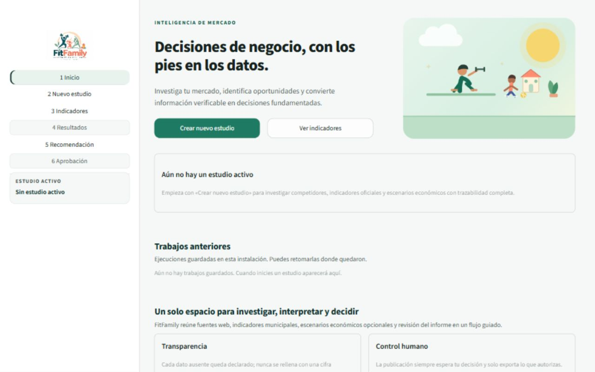
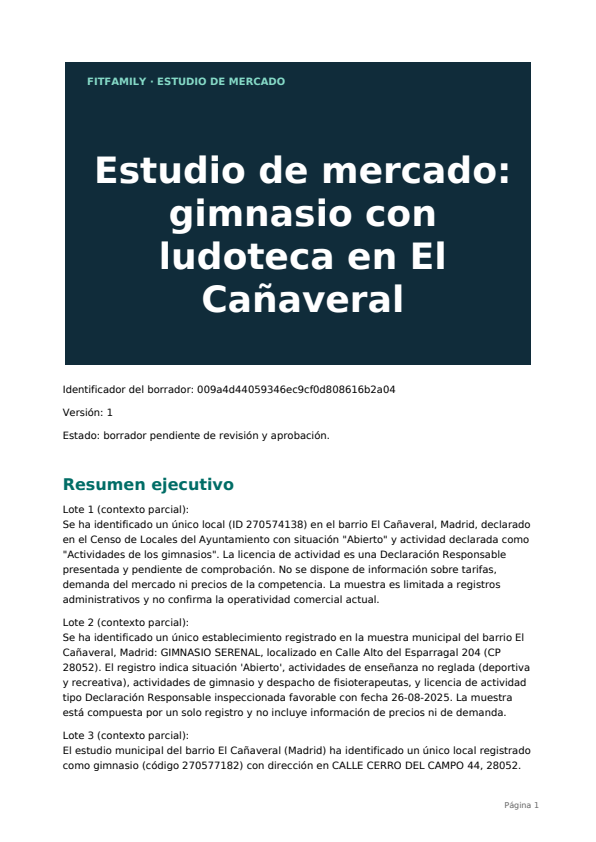

<p align="center">
  
</p>

<h1 align="center">FitFamily</h1>

<p align="center">
  <strong>Market research and traceable reports for a gym with childcare in El Cañaveral, Madrid</strong>
</p>

<p align="center">
  <strong>Team</strong> · Juan · Laura · Gema · María · Isabela
</p>

<p align="center">
  <a href="#setup">Setup</a> ·
  <a href="#local-demos">Demo</a> ·
  <a href="#workflow">Workflow</a> ·
  <a href="#documentation">Documentation</a> ·
  <a href="README.md">Versión en español</a>
</p>

<p align="center">
  
  
  
  
  
  
</p>

This English guide covers installation, configuration and Studio. The [Spanish README](README.md) also documents the backend API and includes additional examples.

FitFamily combines web research, municipal records, economic analysis, report writing and review in a LangGraph workflow. The case study compares the local offer and explores scenarios for opening a gym with childcare in El Cañaveral, Madrid.



## Workflow

1. Research gathers sources, competitor records and evidence.
2. Analysis computes monthly revenue, variable costs, monthly result and break-even. Each metric retains its scenario, inputs, units and original calculation.
3. The report combines evidence, assumptions, charts and limitations. Writing can use a deterministic renderer or CrewAI with Groq.
4. Review checks the report and its references against the research and analysis.
5. Human approval authorizes Markdown or PDF export and, when selected, a CSV tracking update. The decision is tied to the displayed draft version and fingerprint. Changes to the draft, research or analysis require a fresh review.

LangGraph persists execution state in SQLite. FitFamily Studio provides screens for studies, official indicators, results, recommendations, approval and delivery.

## Setup

Use Python 3.13, the version used by GitHub Actions. Run the following from the repository root.

```bash
git switch dev
python -m venv .venv
```

Activate the environment using the command for your shell.

| Shell | Command |
|---|---|
| Git Bash on Windows | `source .venv/Scripts/activate` |
| PowerShell | `./.venv/Scripts/Activate.ps1` |
| macOS or Linux | `source .venv/bin/activate` |

```bash
python -m pip install -r requirements.txt
```

Copy [.env.example](.env.example) to a local .env file. If you already have one, update its settings in place.

| Variable | Purpose |
|---|---|
| GROQ_API_KEY | Groq credentials for writing and visual analysis. |
| WRITER_LLM_MODEL | Text model with the groq/ prefix. |
| VISION_LLM_MODEL | Optional image-capable Groq model. |
| TAVILY_API_KEY | Optional alternate web search provider. |
| FITFAMILY_CHECKPOINTS_DB and FITFAMILY_EVENTS_DB | SQLite paths for checkpoints and events. |
| FITFAMILY_OUTPUT_DIR and FITFAMILY_TRACKING_CSV | Report and delivery tracking paths. |

Run Studio:

```bash
python -m streamlit run src/ui/app.py
```

Open the local URL printed by Streamlit. Start from **Nuevo estudio**, then review the draft under **Aprobación y entrega**. **Solicitar cambios** rejects that version and blocks delivery. For programmatic execution, see the [backend example](README.md#ejecutar-el-workflow).

## Local demos

```bash
python demo_review.py --markdown
python -m src.mcp.client
python -m pytest -q
```

The review demo uses fictional inputs. It checks a correct calculation, detects an altered value and invalidates a review when an assumption changes. The MCP demo queries the local official indicators. CI runs the test suite, checks that Streamlit starts and verifies the shared workflow nodes.

## Groq report example

On 5 November 2026, a real Groq writing run used three saved municipal records and three fictional economic scenarios. It produced **11 sections, 26 claims and 12 metrics**. Automated review found zero issues and returned pending_review. Markdown and PDF previews were generated for human review.



The example uses saved data. The Studio rejection and approved delivery tests use simulated search and writing. Reproduce the report example with a configured Groq provider using:

```bash
python scripts/demo_groq_report.py
```

The previews are written to outputs/demo_groq. See the [recorded result](docs/demo-groq-result.json).

## Municipal data

### What the published data says

| Indicator | Value | Reference | Nature |
|---|---:|---|---|
| Total population | 27,480 | 1 Oct 2026 | Observed: Municipal Register, sum of ages |
| Population under 20 | 28.29% | 1 Oct 2026 | Derived: 7,774 / 27,480 |
| Total population at 1 Jan 2025 | 21,492 | 1 Jan 2025 | Observed: official household file |
| Households | 8,140 | 1 Jan 2025 | Observed: exact sum of 9 census sections |
| Average household size | 2.64 people/household | 1 Jan 2025 | Derived: 21,492 / 8,140 |
| Households with minors | 3,071 | 1 Jan 2025 | Verifiable minimum |
| Open premises | 234 | downloaded 20 Oct 2026 | Observed: Premises Census |
| Registered gyms | 9 | downloaded 20 Oct 2026 | Observed: activity code 931008 |
| Sports and recreation | 4 | downloaded 20 Oct 2026 | Observed: code 855002 |
| Children’s leisure | 3 | downloaded 20 Oct 2026 | Observed: codes 932001 and 932002 |
| Community pools | 3 | downloaded 20 Oct 2026 | Observed: code 931010 |
| Families with children | `null` | — | Unavailable: not an official neighbourhood category |
| Gyms with a playroom | `null` | — | Unavailable: no code combines both activities |

**Do not mix these periods.** October 2026 population and January 2025 households are different references. For household ratios, use `population_total_2025` or the already calculated average household size; do not divide 2026 population by 2025 households.

### What the competitor registry adds

`data/processed/competitor_registry.json` is a snapshot generated on **21 October 2026** from the Municipal Premises and Activities Census:

- **18 premises** with activity relevant to the study.
- **16** with licence information; a missing licence means “no information”, never “denied”.
- **14 of 18** with usable coordinates.
- **0 known prices** and **0 confirmed playrooms** in the committed artefact.
- Gym, sports, children’s leisure, and pool categories **overlap**: do not add 9 + 4 + 3 + 3 and call it 19 distinct premises.

A registered premises is not necessarily an operating business, and an administrative licence does not prove that the establishment is open. There is also no census of “gyms with a playroom”: that variable must be confirmed site by site.

## Documentation

| Guide | Contents |
|---|---|
| [Spanish README](README.md) | Full setup, configuration and backend workflow example. |
| [Research](docs/research-module.md) | Web research and evidence provenance. |
| [Source audit](docs/auditoria-fuentes-datos.md) | Municipal sources, periods and methodology. |
| [Economic analysis](docs/analysis.md) | Calculation inputs and indicators. |
| [Visual analysis](docs/multimodal.md) | Visual provider setup and tests. |
| [Report delivery](docs/report-export.md) | Approval and export behavior. |
| [Review](docs/review-quality.md) | Review checks and correction routes. |
| [Studio approval](docs/streamlit-approval.md) | Preview and human approval contract. |

The report distinguishes observed evidence, derived values and assumptions. Results depend on the data and scenario inputs available for the study.

## Licence

Distributed under the [MIT licence](LICENSE).
