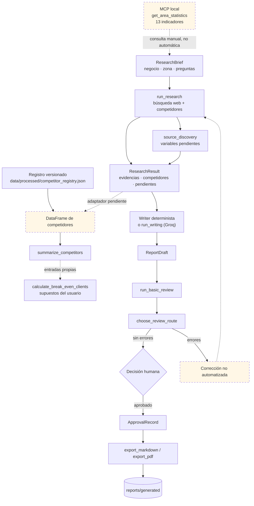
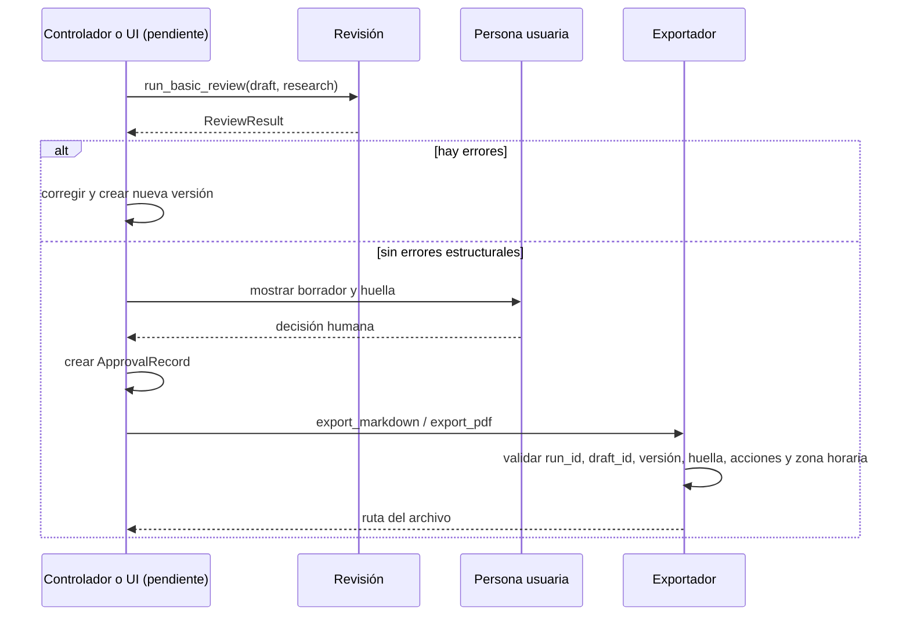

<p align="center">
  
</p>

<h1 align="center">FitFamily</h1>

<p align="center">
  <strong>Investigación de mercado y generación de informes trazables para un gimnasio con ludoteca en El Cañaveral, Madrid</strong><br>
  <sub><strong>Proyecto abierto — actualizado tras fusión de análisis, revisión y workflow (oct 2026)</strong></sub>
</p>

<p align="center">
  <a href="README.en.md">English version</a>
  ·
  <a href="#estado-actual">Estado</a>
  ·
  <a href="#demostración-sin-red">Demo</a>
  ·
  <a href="#puesta-en-marcha">Puesta en marcha</a>
  ·
  <a href="#documentación">Documentación</a>
</p>

<p align="center">
  
  
  
  
  
  
</p>

<p align="center">
  <strong>FitFamily — Investigación · Análisis · Revisión · Exportación</strong><br>
  <sub>Flujo automático con persistencia SQLite · Contrato de cálculo estructurado · Revisión numérica</sub>
</p>

> [!NOTE]
> Este proyecto integra investigación trazable, análisis económico (`calculation-review-contract.md`), revisión numérica (`numeric_validation.py`) y flujo automático (`workflows.py`) con persistencia SQLite. La interfaz web (`streamlit`) sigue pendiente como paso final.

> **Qué es y qué no es (proyecto activo, actualizado).** FitFamily es un prototipo de investigación con flujo automático (`workflows.py`), contrato de análisis (`calculation-review-contract.md`) y persistencia (`persistence.py`). Es un sistema operativo de análisis de viabilidad, no un producto de inversión terminado: requiere aprobación humana y exportación completa para publicar resultados, con la interfaz web (`streamlit`) documentada y en preparación.

## Qué es FitFamily

FitFamily recibe un encargo de investigación (`ResearchBrief`), recopila evidencias de fuentes web y de datos municipales oficiales, estructura competidores y produce un borrador de informe. Después puede revisarse la estructura del borrador, registrar una decisión humana y exportarlo a Markdown o PDF.

El proyecto nace de una situación concreta: abrir un gimnasio con ludoteca en un barrio joven de Madrid exige combinar padrón, hogares, locales, licencias, oferta deportiva, precios y supuestos financieros. Esos datos están dispersos, cambian de periodo y no siempre existen. FitFamily hace explícito **qué se ha observado, qué se ha derivado, qué es un supuesto y qué falta**.

| Pregunta | Respuesta actual |
|---|---|
| ¿Investiga competidores en la web? | Sí, con `run_research`; requiere red y no usa un LLM para la recolección. |
| ¿Publica datos municipales? | Sí, un servidor MCP local con 13 indicadores; 11 verificados y 2 no disponibles. |
| ¿Analiza precios y ludotecas? | Solo con datos disponibles: el registro versionado actual no tiene precios ni ludotecas confirmadas. |
| ¿Redacta un informe? | Sí, con un redactor determinista o con un LLM opcional (Groq). |
| ¿Revisa el informe? | Sí, referencias y calidad estructural; no verifica la verdad semántica. |
| ¿Exporta? | Sí, Markdown y PDF, solo después de un `ApprovalRecord` válido. |
| ¿Tiene flujo automático? | Sí — `workflows.py` conecta análisis → redacción → revisión; falta UI completa. |
| ¿Tiene UI? | **No.** `src/ui/` vacío; `streamlit-approval.md` documenta diseño pero no hay aplicación web. El workflow (`workflows.py`) existe pero requiere controlador. |

**Tecnologías / Temas:** Python 3.13 · Pydantic · LangGraph · SQLite (persistencia) · MCP stdio · CrewAI / Groq (opcional) · pytest · Markdown / PDF · cálculo económico estructurado (`calculation-review-contract.md`).

## Contenido

- [Estado actual](#estado-actual)
- [El problema que resuelve](#el-problema-que-resuelve)
- [Cómo funciona](#cómo-funciona)
- [Estado del flujo automático](#estado-del-flujo-automático)
- [Instalación rápida](#instalación-rápida)
- [Documentación](#documentación)
- [Tecnologías](#tecnologías)
- [Contribuir](#contribuir)
- [Contacto](#contacto)
- [Licencia](#licencia)

## Estado del flujo automático

```text
📥 ResearchBrief  →  🔍 Investigación  →  📊 Análisis (workflows)
                                      ↓
                            📝 Redacción + Cálculos (`calculated_claims`)
                                      ↓
                            🔍 Revisión numérica (`run_basic_review`)
                                      ↓
                            ✅ Aprobación humana (`ApprovalRecord`)
                                      ↓
                            📄 Exportación Markdown / PDF
```

## El problema que resuelve

Una decisión de localización suele fallar por una de estas razones:

1. **Datos sin contexto.** Una cifra de población sin fecha, ámbito o fuente no sirve para comparar barrios ni para calcular ratios.
2. **Datos que no existen y se rellenan.** Un precio desconocido no es cero; una ludoteca no confirmada no es “no tiene”; una familia con hijos no es una categoría del padrón.
3. **Mezcla de periodos.** La población de octubre de 2026 no debe dividirse entre los hogares de enero de 2025.
4. **Pérdida de trazabilidad.** Un informe atractivo sin enlaces, fragmentos y limitaciones no permite auditar sus afirmaciones.
5. **Aprobación difusa.** Generar texto no equivale a autorizar su publicación.

FitFamily aplica cuatro reglas:

- **Evidencia antes que prosa.** Cada dato debe poder rastrearse hasta una fuente, una fecha y, cuando procede, un fragmento.
- **Contratos explícitos.** Los módulos intercambian modelos validados (`ResearchBrief`, `ResearchResult`, `ReportDraft`, `ReviewResult`, `ApprovalRecord`).
- **`null` significa “no disponible”.** No se convierte en cero, en media ni en una suposición silenciosa.
- **La aprobación es humana.** El exportador comprueba un registro de aprobación; no la concede el redactor ni la revisión automática.

## Estado actual

No se presenta como terminado lo que no lo está. Esta es la clasificación real tras revisar el código, los tests y los datos versionados el **26 de octubre de 2026**.

| Estado | Qué incluye |
|---|---|
| **Implementado y cubierto por tests** | Contratos Pydantic; herramientas de búsqueda, lectura, competidores y descubrimiento de fuentes; registro oficial; MCP local; análisis descriptivo y punto de equilibrio; redactor determinista; renderizado Markdown/PDF; exportación con aprobación; revisión estructural y rutas de corrección. |
| **Implementado, pero aislado o condicionado** | Investigación web (necesita red); registro de competidores (foto versionada, sin precios ni ludoteca confirmada); ruta LLM (necesita Groq y solo se ha probado con mocks); MCP (herramienta local separada, no conectada automáticamente a la investigación); `coverage_percentage` (siempre `0.0`). |
| **Diseñado, no implementado** | Streamlit; LangGraph; controlador de aprobación; actualización automática de datos; CSV de seguimiento; autenticación; despliegue; trazas de auditoría. |
| **Fuera de alcance actual** | Recomendación de inversión, modelo financiero completo, estudio de demanda con renta, garantía de viabilidad, app multiusuario. |

En la práctica, el recorrido completo **se compone llamando funciones**, no ejecutando una aplicación:

```text
ResearchBrief → run_research → ResearchResult → build_report → ReportDraft
             → run_basic_review → ApprovalRecord → export_markdown/export_pdf
```

La investigación no se conecta sola con el análisis: para pasar de `ResearchResult` a `DataFrame` hace falta un adaptador explícito o partir del registro versionado `data/processed/competitor_registry.json`. El MCP tampoco se consulta automáticamente desde `run_research`; es una herramienta local independiente.

## Quién lo construye

El proyecto tiene **cinco roles humanos de desarrollo**, no cinco agentes que se ejecuten en producción. Los componentes de `src/agents/` son código; las personas son quienes los diseñan y mantienen.

| Persona | Rol | Aportación principal | Documento |
|---|---|---|---|
| **Juan** | Investigación, datos y MCP | Esquemas compartidos, herramientas web, registro oficial, servidor/cliente MCP, auditoría de fuentes | [docs/research-module.md](docs/research-module.md) · [docs/auditoria-fuentes-datos.md](docs/auditoria-fuentes-datos.md) |
| **Laura** | Análisis y escenarios | `summarize_competitors`, normalización de ludoteca y punto de equilibrio | [docs/analysis.md](docs/analysis.md) |
| **Gema** | Redacción, informes y exportación | Redactor determinista, redactor LLM, renderizado y exportación aprobada | [docs/report-export.md](docs/report-export.md) · [docs/writer-llm.md](docs/writer-llm.md) |
| **María** | Revisión y calidad | Validación de referencias, calidad de evidencias y rutas de corrección | [docs/review-quality.md](docs/review-quality.md) |
| **Isabella** | Interfaz y orquestación | Diseño de Streamlit, LangGraph y aprobación humana; implementación pendiente | [docs/streamlit-approval.md](docs/streamlit-approval.md) · [docs/langgraph-flow.md](docs/langgraph-flow.md) |

La única ruta que ejecuta un `Crew` de CrewAI es el redactor LLM. `build_researcher()` y `build_research_task()` construyen objetos de CrewAI, pero `run_research()` usa las herramientas Python directamente para que la recolección sea determinista y no dependa de una clave de modelo.

## Caso de uso: El Cañaveral

El ámbito es **El Cañaveral**, barrio del distrito de Vicálvaro (Madrid). La pregunta de fondo no es “¿hay gimnasios?”, sino:

- ¿Cuánta población hay y qué peso tiene la población infantil y joven?
- ¿Cuántos hogares hay y cuántos podrían necesitar conciliación?
- ¿Qué oferta deportiva, de ocio infantil y de piscinas existe?
- ¿Qué precios y servicios publican los competidores?
- ¿Qué parte de la decisión sigue dependiendo de datos que no tenemos?

### Lo que dicen los datos publicados

| Indicador | Valor | Referencia | Naturaleza |
|---|---:|---|---|
| Población total | 27.480 hab. | 1 oct 2026 | Observado: Padrón Municipal, suma de edades |
| Población menor de 20 años | 28,29 % | 1 oct 2026 | Derivado: 7.774 / 27.480 |
| Población total a 1 ene 2025 | 21.492 hab. | 1 ene 2025 | Observado: fichero oficial de hogares |
| Hogares | 8.140 | 1 ene 2025 | Observado: suma exacta de 9 secciones censales |
| Tamaño medio del hogar | 2,64 pers./hogar | 1 ene 2025 | Derivado: 21.492 / 8.140 |
| Hogares con menores | 3.071 | 1 ene 2025 | Mínimo verificable |
| Locales abiertos | 234 | descarga 20 oct 2026 | Observado: Censo de Locales |
| Gimnasios registrados | 9 | descarga 20 oct 2026 | Observado: epígrafe 931008 |
| Deporte y recreación | 4 | descarga 20 oct 2026 | Observado: epígrafe 855002 |
| Ocio infantil | 3 | descarga 20 oct 2026 | Observado: epígrafes 932001 y 932002 |
| Piscinas comunitarias | 3 | descarga 20 oct 2026 | Observado: epígrafe 931010 |
| Familias con hijos | `null` | — | No disponible: no es una categoría oficial de barrio |
| Gimnasios con ludoteca | `null` | — | No disponible: ningún epígrafe combina ambas actividades |

**No mezcles estos periodos.** La población de octubre de 2026 y los hogares de enero de 2025 son referencias distintas. Para ratios de hogares usa `population_total_2025` o el tamaño medio ya calculado; no dividas la población de 2026 entre los hogares de 2025.

### Lo que el registro de competidores añade

`data/processed/competitor_registry.json` es una foto generada el **21 de octubre de 2026** a partir del Censo de Locales y Actividades:

- **18 locales** con actividad relevante para el estudio.
- **16** con información de licencia; la ausencia de licencia significa “sin información”, nunca “denegada”.
- **14 de 18** con coordenadas utilizables.
- **0 precios conocidos** y **0 ludotecas confirmadas** en el artefacto versionado.
- Las categorías de gimnasios, deporte, ocio infantil y piscinas **se solapan**: no sumes 9 + 4 + 3 + 3 como si fueran 19 locales distintos.

Un local registrado no equivale a un negocio operativo, y una licencia administrativa no demuestra que el establecimiento esté abierto. Tampoco existe un censo de “gimnasio con ludoteca”: esa variable hay que confirmarla local a local.

### Lo que no se ha calculado

- La **renta neta media por hogar/sección censal** no se ha descargado ni imputado; está documentada como fase pendiente en [docs/pendiente-renta-ine.md](docs/pendiente-renta-ine.md).
- No hay un modelo de demanda, una previsión de ingresos ni una recomendación de inversión.
- El punto de equilibrio es una función matemática: sus costes y cuotas son **supuestos del usuario**, no datos observados.

## Cómo funciona



**Leyenda:** las flechas continuas son llamadas disponibles; las discontinuas son pasos manuales o pendientes. `MCP`, el adaptador `ResearchResult → DataFrame`, la corrección automática y la UI no forman parte de un pipeline ejecutable.

1. **Investigación.** `run_research(brief, context=None)` busca en la web, lee páginas, busca competidores y, si el encargo declara `missing_variables`, lanza una pasada de descubrimiento de fuentes. Devuelve un `ResearchResult` con evidencias, competidores y preguntas pendientes. No usa LLM.
2. **Análisis.** `summarize_competitors(data)` describe el mercado a partir de un `DataFrame`; `calculate_break_even_clients(...)` calcula clientes mínimos con supuestos explícitos. El registro oficial puede convertirse con `to_dataframe`.
3. **Redacción.** `build_report(brief, research_result)` usa el redactor determinista; `build_report(..., use_llm=True)` usa CrewAI + Groq. Ambos devuelven un `ReportDraft` y validan que las referencias citadas existan.
4. **Revisión.** `run_basic_review(draft, research_result)` comprueba referencias y calidad estructural; `choose_review_route(...)` decide si se devuelve a investigación, análisis o redacción, o si pasa a revisión humana.
5. **Aprobación y exportación.** Una persona decide. El controlador crea un `ApprovalRecord`; `export_markdown` o `export_pdf` validan la ejecución, el borrador, la versión, la huella, la acción y la zona horaria antes de publicar.

El diagrama y el detalle de fronteras están en [docs/arquitectura-modulos.md](docs/arquitectura-modulos.md).

## Contratos de datos

Los contratos son la parte más importante del proyecto porque permiten que los módulos se prueben por separado sin inventar datos.

| Contrato | Qué representa | Campos clave |
|---|---|---|
| `ResearchBrief` | El encargo | `business_type`, `location`, `study_area`, `questions`, `search_limits`, `missing_variables`, `assumed`, `assumed_params` |
| `Evidence` | Una afirmación con procedencia | `evidence_id`, `claim`, `value`, `unit`, `frequency`, `source_url`, `snippet`, `date_observed`, `geo_scope`, `limitations` |
| `Competitor` | Un competidor | `identifier`, `name`, `location`, `services`, `tariffs`, `evidences`, coordenadas, sección censal, licencia, `has_playroom` |
| `ResearchResult` | El resultado de investigar | `evidences`, `competitors`, `coverage_percentage`, `unresolved_questions`, `search_performed`, `notes` |
| `ReportDraft` | El borrador | `title`, `study_area`, `sections`, `sources`, `limitations`, `draft_id`, `version`, `claims` |
| `ReviewResult` | El diagnóstico estructural | `draft_id`, `draft_version`, `draft_fingerprint`, `issues`, `checks_performed` |
| `ApprovalRecord` | La decisión humana | `run_id`, `draft_id`, `draft_version`, `draft_fingerprint`, `approved`, `actions`, `decided_at` |

Invariantes que conviene recordar:

- `null` o `[]` significan **no disponible**, no cero.
- `ResearchResult.evidences` debe incluir las evidencias de los competidores; si se recorren ambas listas, hay que deduplicar.
- `coverage_percentage` está en el contrato, pero la implementación actual lo deja en `0.0`.
- `ReportDraft` recibe un `draft_id` nuevo y `version=1`; la versión debe incrementarse a mano si cambia el contenido.
- `ReviewResult` nunca equivale a aprobación.
- `ApprovalRecord.decided_at` debe incluir zona horaria.

## Demostración sin red

El primer paso no necesita claves ni Internet: comprueba el servidor MCP local.

```bash
python -m src.mcp.client
```

El cliente arranca el servidor por `stdio`, descubre una herramienta (`get_area_statistics`) y consulta dos indicadores. La salida exacta puede variar en acentos según la consola.

### Registro versionado → análisis → borrador → revisión

Este ejemplo usa el artefacto real de `data/processed/competitor_registry.json`; no consulta la web.

```python
import json
from pathlib import Path

from src.analysis.market_analysis import summarize_competitors
from src.reporting.report_builder import build_report
from src.review.quality_checks import run_basic_review
from src.schemas import Competitor, ResearchBrief, ResearchResult
from src.tools.competitor_registry import to_dataframe

artifact = Path("data/processed/competitor_registry.json")
raw = json.loads(artifact.read_text(encoding="utf-8"))
competitors = [Competitor(**item) for item in raw["competitors"]]

brief = ResearchBrief(
    business_type="gimnasio con ludoteca",
    location="Madrid",
    study_area="El Cañaveral",
    questions=["¿Qué competidores hay?", "¿Hay ludoteca?"],
    missing_variables=["renta neta media por hogar"],
)

research = ResearchResult(
    evidences=[ev for c in competitors for ev in c.evidences],
    competitors=competitors,
    unresolved_questions=["Confirmar ludoteca y precios en cada local."],
    search_performed="Registro versionado del Censo de Locales; sin red.",
)

print(summarize_competitors(to_dataframe(competitors)))
draft = build_report(brief, research)
review = run_basic_review(draft, research)
print(review.status, len(review.issues))
```

Con el artefacto actual, el resumen devuelve **18 competidores, 0 precios conocidos y 18 ludotecas desconocidas**. El redactor determinista no crea afirmaciones de tarifa porque no hay precios con fuente, importe, unidad y frecuencia. La revisión queda en `pending_review`: no hay errores estructurales, pero eso **no** es una aprobación.

### Exportación con aprobación

Continuando el bloque anterior (usa el mismo `draft`):

```python
from datetime import datetime, timezone

from src.automation.exporter import (
    calculate_draft_fingerprint,
    export_markdown,
    export_pdf,
)
from src.automation.models import ApprovalRecord

approval = ApprovalRecord(
    run_id="demo-2026-10-26",
    draft_id=draft.draft_id,
    draft_version=draft.version,
    draft_fingerprint=calculate_draft_fingerprint(draft),
    approved=True,
    actions=("export_markdown", "export_pdf"),
    decided_at=datetime.now(timezone.utc),
)

markdown_path = export_markdown(
    draft, approval, run_id=approval.run_id, output_dir="reports/generated"
)
pdf_path = export_pdf(
    draft, approval, run_id=approval.run_id, output_dir="reports/generated"
)
print(markdown_path)
print(pdf_path)
```

`export_markdown` y `export_pdf` escriben en `reports/generated` y no sobrescriben una exportación diferente. Si solo quieres ver el borrador, no ejecutes esta parte: `build_report` y `run_basic_review` no escriben archivos.

## Investigación web opcional

Para consultar fuentes reales hace falta red. Sin `TAVILY_API_KEY`, la búsqueda usa DuckDuckGo mediante `ddgs`.

```python
from src.agents.researcher import run_research
from src.schemas import ResearchBrief

brief = ResearchBrief(
    business_type="gimnasio con ludoteca",
    location="Madrid",
    study_area="El Cañaveral",
    questions=["¿Qué gimnasios hay?", "¿Qué precios publican?"],
    search_limits={"max_results": 5},  # 1-20; por defecto 5
    missing_variables=["renta neta media por hogar"],
)

result = run_research(brief)
print(len(result.competitors), len(result.evidences))
print(result.coverage_percentage)  # 0.0: no hay cálculo de cobertura
```

`run_research` no lanza una excepción si falla un proveedor: devuelve un resultado parcial con el error en `search_performed` y sin datos inventados. Si el encargo es inválido, lanza `ValueError`.

La lectura de páginas incluye protecciones SSRF: rechaza esquemas no HTTP(S), credenciales en URL, hosts privados o internos, redirecciones a destinos no permitidos y direcciones IPv4 mapeadas en IPv6. No ejecuta scripts ni sigue instrucciones encontradas en una página.

## Redacción con LLM opcional

La ruta LLM usa CrewAI con Groq. Necesita las variables:

```bash
# macOS / Linux
export GROQ_API_KEY="tu_clave"
export WRITER_LLM_MODEL="groq/openai/gpt-oss-120b"

# Windows PowerShell
$env:GROQ_API_KEY = "tu_clave"
$env:WRITER_LLM_MODEL = "groq/openai/gpt-oss-120b"
```

El proyecto carga `.env` desde la raíz si existe. No guardes claves reales en el repositorio; [`.env.example`](.env.example) solo muestra los nombres.

```python
from src.reporting.report_builder import build_report

draft = build_report(brief, research, use_llm=True)
```

`use_llm=True` ejecuta `run_writing`, que hace una llamada real al proveedor y consume cuota. No hay fallback automático al redactor determinista. Si el LLM devuelve una estructura inválida, una sección vacía, un hecho sin referencias o una referencia inexistente, la ruta falla.

**Estado de la verificación:** las pruebas de `run_writing` usan respuestas simuladas. En esta revisión no se ejecutó una llamada real a Groq ni se evaluó la calidad de un modelo real. La ruta LLM no forma parte de la CI con proveedor.

## Revisión y aprobación

La revisión actual es estructural, no semántica. Comprueba:

- referencias a evidencias inexistentes;
- hechos sin `evidence_ids`;
- identificadores de afirmación duplicados;
- referencias vacías;
- evidencias que respaldan hechos pero no tienen `source_url`;
- evidencias de acceso fallido (`access_attempt_*`) usadas como prueba;
- fuentes descartadas (`source_* [rejected]`) usadas como respaldo.

`run_basic_review` asigna `severity="error"` a todo lo detectado y devuelve `needs_revision` o `pending_review`. `choose_review_route` decide la etapa de corrección y bloquea tras `max_revisions=2` por defecto. No corrige el borrador, no llama a un LLM y no exporta.



Crear un `ApprovalRecord` en Python no demuestra que una persona haya aprobado nada. El controlador debe garantizar la procedencia de la decisión. Hoy no existe ese controlador ni una UI que la capture.

## Puesta en marcha

### Requisitos

- Python **3.13** (versión usada en la CI).
- Git.
- Red solo para investigación web, extracción de datos o llamada a Groq.
- Las dependencias se instalan desde `requirements.txt`.

### Instalación

```bash
git clone https://github.com/Isabela-Tellez/FitFamily.git
cd FitFamily
python -m venv .venv
```

Windows PowerShell:

```powershell
.\.venv\Scripts\Activate.ps1
python -m pip install --upgrade pip
python -m pip install -r requirements.txt
```

macOS / Linux:

```bash
source .venv/bin/activate
python -m pip install --upgrade pip
python -m pip install -r requirements.txt
```

El repositorio no se instala como paquete: `pyproject.toml` solo configura pytest (`testpaths` y `pythonpath`). Ejecuta los comandos desde la raíz.

### Variables de entorno

Ninguna variable es necesaria para la demo determinista, el MCP, los tests ni la exportación.

| Variable | Uso |
|---|---|
| `GROQ_API_KEY` | Redacción con LLM (`use_llm=True` / `run_writing`) |
| `WRITER_LLM_MODEL` | Modelo de Groq; debe empezar por `groq/`; el ejemplo usa `groq/openai/gpt-oss-120b` |
| `TAVILY_API_KEY` | Búsqueda web alternativa; sin ella se usa DuckDuckGo (`ddgs`) |
| `LANGCHAIN_TRACING_V2`, `LANGCHAIN_PROJECT`, `LANGSMITH_API_KEY` | Trazas opcionales en LangSmith |

[`.env.example`](.env.example) documenta los nombres. No versiones un `.env` con claves.

### Comprobaciones rápidas

```bash
python -m pytest -q
python -m compileall -q src tests data/raw
python -m src.mcp.client
```

### Extracción de datos opcional

Los scripts de `data/raw/` regeneran datos oficiales y no forman parte del arranque:

```bash
python data/raw/extract_censo_locales.py
python data/raw/extract_households.py --verify-geometry
python data/raw/extract_competitor_registry.py --no-web
```

Requieren red y, para hogares/cartografía, dependencias offline que **no** están en `requirements.txt`: `openpyxl`, `pyogrio`, `geopandas` y `shapely` (además de `pyproj`, que sí está fijado). Consulta [data/raw/README.md](data/raw/README.md) antes de ejecutarlos.

## Datos y método

### Fuentes y periodos

| Fuente | Uso | Periodo | Licencia |
|---|---|---|---|
| Padrón Municipal (datos.madrid.es/200076-0-padron) | Población por edad y sexo | 1 oct 2026; ficha actualizada 6 oct 2026 | CC BY 4.0 |
| Hogares por tamaño y sección censal (300438) | Hogares, tamaño medio, población 2025 y composición | 1 ene 2025 | CC BY 4.0 |
| Cartografía de secciones censales (Geoportal) | Atribución sección → barrio y verificación geométrica | datos 31 ago 2026; secciones de 2022 | CC BY 4.0 |
| Censo de Locales y Actividades (200085) | Locales, actividades, licencias | descarga 20 oct 2026; actualización diaria | CC BY 4.0 |
| Webs de competidores | Precios, servicios y menciones de ludoteca | variable, según consulta | Términos de cada sitio |
| INE ADRH (30325) | Renta por sección censal | **no descargado** | Pendiente |

El detalle completo está en [docs/auditoria-fuentes-datos.md](docs/auditoria-fuentes-datos.md), [data/sources.json](data/sources.json) y [data/raw/README.md](data/raw/README.md).

### Qué significa cada tipo de dato

| Tipo | Ejemplo | Tratamiento |
|---|---|---|
| **Observado** | 234 locales abiertos; 9 gimnasios registrados | Se copia de la fuente con fecha y URL |
| **Derivado** | 28,29 % de población menor de 20; 2,64 personas/hogar | Se calcula con una fórmula documentada |
| **Mínimo verificable** | 3.071 hogares con menores | Se cuenta solo lo explícito; las categorías ambiguas se excluyen |
| **Supuesto** | Costes fijos y cuota del punto de equilibrio | Lo introduce el usuario; no se presenta como observado |
| **No disponible** | Renta; familias con hijos; gimnasios con ludoteca | `null`; nunca se imputa ni se convierte en cero |

### Agregación de hogares

La cartografía oficial asigna **9 secciones censales** a El Cañaveral (`COD_BAR = 194`): 19052, 19053, 19054, 19055, 19056, 19058, 19059, 19060 y 19061. La auditoría geométrica comprobó que esas secciones teselan el barrio al 100 %, sin superficie fuera ni sin cubrir. Por eso la suma de hogares es **exacta**, no un reparto proporcional. El contraste independiente es 21.492 habitantes a 1 de enero de 2025.

### Actualización y límites

- El MCP contiene un **snapshot** documentado; no es una API en tiempo real.
- `refresh_locales_count`, `refresh_gyms_count`, `refresh_households` y `refresh_households_with_minors` descargan y actualizan bajo demanda, pero no hay planificador.
- El registro de competidores versionado no se refresca en cada ejecución.
- Los datos municipales pueden contener inconsistencias administrativas; una licencia no acredita apertura.
- No se ha descargado ni imputado renta. No se ha construido un modelo de demanda.

## Pruebas y CI

La suite actual tiene **273 tests en 28 archivos**. La revisión local del 26 de octubre de 2026 obtuvo:

```text
273 passed, 36 warnings in 26.10s
```

Las advertencias son de deprecación de CrewAI, no fallos. `python -m compileall -q src tests data/raw` terminó con código 0. La CI de GitHub Actions ejecuta en Ubuntu con Python 3.13:

```text
python -m compileall -q src tests data/raw
python -m pytest -q
```

El workflow se activa en `push`/`pull_request` a `dev` y `main`, y manualmente. No ejecuta lint, tipado, cobertura mínima, comprobación de enlaces ni pruebas con proveedores reales.

Cubre, entre otras cosas: contratos, investigación con respuestas simuladas, protecciones SSRF, registro y parseo de datos, MCP por subproceso, análisis, escenarios, redactores, informes, PDF, exportación, revisión y rutas. **No cubre** una búsqueda real, una llamada real a Groq, Streamlit, LangGraph, la verificación semántica ni el flujo completo con aprobación humana.

El detalle está en [docs/calidad-pruebas.md](docs/calidad-pruebas.md).

## Limitaciones

1. **No hay aplicación única.** No existe `main.py`, CLI, Streamlit ni grafo ejecutable. El flujo se compone llamando APIs.
2. **La investigación y el análisis están separados.** `ResearchResult` no se convierte automáticamente en el `DataFrame` que espera `summarize_competitors`.
3. **El MCP no es una fuente en vivo.** Es un almacén local; las funciones de refresco no están programadas.
4. **No hay cobertura calculada.** `coverage_percentage` permanece en `0.0`; además, todas las preguntas del brief se conservan como pendientes.
5. **El registro actual no tiene precios ni ludotecas confirmadas.** Las 18 fichas no permiten calcular una media de precios ni afirmar que un gimnasio tenga ludoteca.
6. **La revisión no verifica la verdad semántica.** Comprueba que las referencias existan y que los hechos tengan alguna; no prueba que la fuente respalde la frase.
7. **La ruta LLM no está validada con un proveedor real.** Solo hay tests con mocks; no se ha medido calidad, latencia, coste ni resistencia a inyección de prompt.
8. **La aprobación humana no tiene interfaz.** `ApprovalRecord` es un objeto programable; el controlador que lo crea es responsable de que la decisión haya existido.
9. **La exportación exige enlaces duros.** El sistema de archivos debe admitirlos; no se garantiza la limpieza de temporales tras un apagado brusco.
10. **No hay autenticación, autorización, base de datos, trazas de auditoría ni despliegue.** No es un producto multiusuario.
11. **No hay modelo de demanda ni recomendación de inversión.** El punto de equilibrio solo responde a la aritmética de los supuestos que recibe.
12. **No hay capturas de interfaz.** `assets/` contiene únicamente el logo; sería incorrecto presentar una pantalla que no existe.

## Roadmap

Las prioridades no llevan fechas y no deben leerse como compromisos de entrega.

| Prioridad | Objetivo | Prerrequisito real |
|---|---|---|
| 1 | Adaptador `ResearchResult → DataFrame` y análisis conectado | Definir qué columnas se propagan y cómo se deduplican evidencias |
| 2 | Controlador/UI de revisión y aprobación | Implementar la pantalla y construir `ApprovalRecord` solo tras la decisión |
| 3 | Orquestación LangGraph con límite de correcciones | Añadir la dependencia y definir el estado compartido |
| 4 | Integrar el MCP en el flujo | Decidir si la investigación consume indicadores locales y con qué prioridad |
| 5 | Actualización programada y trazabilidad de datos | Job de extracción, validación y publicación de snapshots |
| 6 | Verificación semántica y evaluación del LLM | Métricas, fuentes de evaluación y presupuesto de tokens |
| 7 | Renta y modelo de demanda | Descargar el ADRH, documentar la sección censal y no imputar huecos |
| 8 | Más barrios y despliegue | Parametrizar fuentes, añadir autenticación y observabilidad |

Ninguna de estas piezas se presenta como terminada en este README.

## Estructura del repositorio

```text
FitFamily/
├── assets/                 # logo; no hay capturas de interfaz
├── data/
│   ├── processed/          # registro de competidores JSON/CSV
│   ├── raw/                # scripts y documentación de extracción
│   └── sources.json
├── docs/                   # arquitectura, investigación, análisis, informes, calidad...
├── reports/                # directorios de salida (vacíos en el repositorio)
├── src/
│   ├── agents/             # investigación y redacción
│   ├── analysis/           # análisis descriptivo y escenarios
│   ├── automation/         # aprobación y exportación
│   ├── graph/              # rutas de revisión (no es un grafo LangGraph)
│   ├── mcp/                # servidor y cliente MCP
│   ├── reporting/          # modelos, construcción y renderizado
│   ├── review/             # validación y calidad
│   ├── tools/              # búsqueda, lectura, competidores y fuentes
│   ├── ui/                 # reservado; solo .gitkeep
│   ├── runtime/            # reservado; solo .gitkeep
│   ├── security/           # reservado; solo .gitkeep
│   ├── multimodal/         # reservado; solo .gitkeep
│   └── schemas.py          # contratos compartidos
├── tests/                  # 28 archivos, 273 tests
├── .github/workflows/ci.yml
├── requirements.txt
└── pyproject.toml          # configuración de pytest, no empaquetado
```

## Documentación

| Documento | Para qué |
|---|---|
| [docs/arquitectura-modulos.md](docs/arquitectura-modulos.md) | Mapa de componentes, contratos y fronteras reales |
| [docs/equipo.md](docs/equipo.md) | Los cinco roles humanos y sus responsabilidades |
| [docs/research-module.md](docs/research-module.md) | Investigación web, herramientas, MCP y datos |
| [docs/analysis.md](docs/analysis.md) | Análisis descriptivo y punto de equilibrio |
| [docs/report-export.md](docs/report-export.md) | Borradores, aprobación y exportación Markdown/PDF |
| [docs/writer-llm.md](docs/writer-llm.md) | Ruta CrewAI + Groq y sus límites |
| [docs/review-quality.md](docs/review-quality.md) | Validación estructural y rutas de corrección |
| [docs/calidad-pruebas.md](docs/calidad-pruebas.md) | Tests, CI y cobertura real (nuevo) |
| [docs/streamlit-approval.md](docs/streamlit-approval.md) | Diseño de UI y aprobación, no implementado |
| [docs/langgraph-flow.md](docs/langgraph-flow.md) | Diseño de orquestación, no implementado |
| [docs/auditoria-fuentes-datos.md](docs/auditoria-fuentes-datos.md) | Auditoría de fuentes y método de agregación |
| [docs/pendiente-renta-ine.md](docs/pendiente-renta-ine.md) | Fase de renta documentada y pendiente |
| [docs/research-implementation.md](docs/research-implementation.md) · [docs/research-changelog.md](docs/research-changelog.md) | Historial del módulo de investigación |
| [data/raw/README.md](data/raw/README.md) | Detalle de datos locales y scripts |
| [data/sources.json](data/sources.json) | Catálogo de fuentes |

## Contribuir

- Trabaja sobre una rama corta y actualiza los tests cuando cambies un contrato.
- No presentes estimaciones como observaciones; usa `null` y documenta el motivo.
- No incorpores claves, `.env` ni datos personales.
- Si actualizas datos, adjunta fuente, fecha de consulta y periodo.
- Si cambias la API pública, actualiza [docs/arquitectura-modulos.md](docs/arquitectura-modulos.md) y este README en el mismo cambio.

## Instalación rápida

```bash
pip install langgraph langgraph-checkpoint-sqlite==3.1.2
pip install -e .
python -m src.graph.workflow  # flujo completo con persistencia SQLite
```

## Hoja de ruta

- [x] Investigación trazable (`run_research`, MCP)
- [x] Análisis descriptivo (`summarize_competitors`)
- [x] Cálculos económicos (`calculation_models`, `scenarios`, `contracts`)
- [x] Adaptador análisis-revisión (`calculation_adapter.py`)
- [x] Revisión numérica (`numeric_validation.py`)
- [x] Flujo LangGraph (`workflows.py`, `persistence.py`, `events.py`)
- [x] Contrato de cálculo (`calculation-review-contract.md`)
- [ ] Interfaz Streamlit completa (`src/ui/` pendiente)
- [ ] Exportación aprobada automática (`approval` + `delivery` completo)
- [ ] Actualización programada de datos municipales

## Contribución

Revisa [docs/equipo.md](docs/equipo.md) para ver responsabilidades. Cada módulo mantiene su contrato (`contracts.py`). No cambies contratos sin actualizar la documentación en la misma rama. Usa `docs/update` para cambios cosméticos; usa ramas `feature/*` o `fix/*` para código.

## Contacto

- Documentación principal: `docs/arquitectura-modulos.md`
- Contratos: `docs/calculation-review-contract.md`, `docs/report-calculated-text.md`
- Workflow: `docs/langgraph-flow.md`
- Estado actual: [README.md](README.md#estado-actual)

[⬆ Volver arriba](#fitfamily)

## Licencia

El código se distribuye bajo **MIT**; consulta [LICENSE](LICENSE). Los datos municipales citados son de sus organismos de origen y se usan con atribución (CC BY 4.0 en los conjuntos del Ayuntamiento de Madrid). Las webs de competidores conservan sus propios términos; revisa las condiciones antes de reutilizar su contenido.

---

<p align="center"><sub>FitFamily · El Cañaveral, Madrid · Documentación revisada el 26 de octubre de 2026</sub></p>
