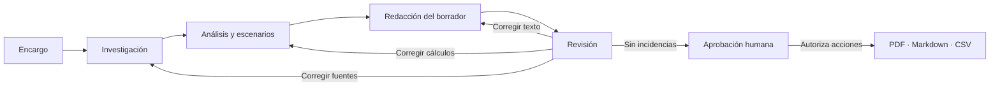
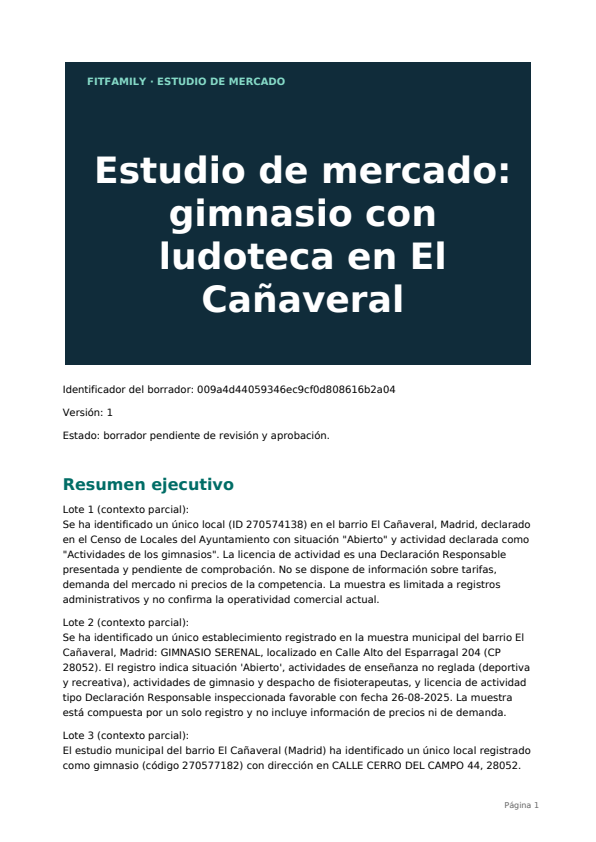

<p align="center">
  
</p>

<h1 align="center">FitFamily</h1>

<p align="center">
  <strong>Investigación de mercado e informes trazables para un gimnasio con ludoteca en El Cañaveral, Madrid</strong>
</p>

<p align="center">
  <a href="#puesta-en-marcha">Instalación</a> ·
  <a href="#demostración-local">Demo</a> ·
  <a href="#flujo-de-trabajo">Workflow</a> ·
  <a href="#documentación">Documentación</a> ·
  <a href="README.en.md">English version</a>
</p>

<p align="center">
  
  
  
  
  
  
  
  
  
  
  
  
</p>

FitFamily reúne investigación web, datos municipales, análisis económico, redacción asistida y revisión en un flujo de LangGraph. El resultado es un borrador con fuentes, supuestos y referencias a los cálculos. Una persona revisa el documento y autoriza su entrega en Markdown, PDF y CSV.

El caso de estudio es la apertura de un gimnasio con ludoteca en El Cañaveral. El informe ayuda a comparar la oferta existente y explorar escenarios de clientela, cuota y costes. Las conclusiones distinguen datos observados, cálculos, hipótesis y preguntas abiertas.

## Funcionalidades

| Área | Qué ofrece |
|---|---|
| Investigación | Búsqueda web, lectura de páginas, descubrimiento de fuentes y registro de competidores. |
| Datos oficiales | Servidor MCP local y datos municipales con fecha, ámbito y procedencia. |
| Análisis | Comparación de competidores, normalización de precios y escenarios económicos reproducibles. |
| Métricas | Ingresos mensuales, costes variables, resultado mensual y punto de equilibrio. |
| Gráficos y visión | Gráficos de precios y escenarios; análisis de imágenes mediante un modelo visual. |
| Redacción | Redactor determinista o CrewAI con Groq; estructura común y citas a evidencias y cálculos. |
| Revisión | Comprobación de referencias, valores, unidades, escenarios y procedencia de los cuatro indicadores. |
| Orquestación | LangGraph, checkpoints SQLite, eventos y recuperación de ejecuciones. |
| Entrega | Aprobación humana por versión y huella; PDF, Markdown y CSV con reintentos de acciones pendientes. |
| Interfaz | Aplicación Streamlit profesional en español: navegación por pasos, indicadores, resultados, recomendación y aprobación con diseño accesible. |

## Flujo de trabajo



El controlador identifica cada ejecución mediante un run_id y conserva el estado del grafo. Una revisión automática satisfactoria deja el documento en pending_review. La decisión humana autoriza las acciones de entrega para un borrador concreto, con su versión y huella.

Los exportadores validan esa autorización. Si una entrega falla parcialmente, el resultado registra las acciones completadas y permite reintentar las pendientes.

La vista previa reutilizable está en [src/ui/report_preview.py](src/ui/report_preview.py). La documentación de integración de la interfaz se encuentra en [docs/streamlit-approval.md](docs/streamlit-approval.md).

## Puesta en marcha

Se utiliza Python 3.13 en GitHub Actions. Instala las dependencias fijadas y ejecuta los comandos desde la raíz del repositorio.

```bash
git clone https://github.com/Isabela-Tellez/FitFamily.git
cd FitFamily
git switch dev
python -m venv .venv
```

Activa el entorno en Git Bash o macOS/Linux:

```bash
# Git Bash en Windows
source .venv/Scripts/activate

# macOS / Linux
source .venv/bin/activate
```

En PowerShell:

```powershell
.\.venv\Scripts\Activate.ps1
```

Instala las dependencias:

```bash
python -m pip install -r requirements.txt
```

### Configuración

Copia .env.example a .env y configura los proveedores que vayas a utilizar. Conserva las claves en el entorno local.

| Variable | Uso |
|---|---|
| GROQ_API_KEY | Redacción y análisis visual mediante Groq. |
| WRITER_LLM_MODEL | Modelo textual con prefijo groq/. Consulta el ejemplo del repositorio. |
| VISION_LLM_MODEL | Modelo de Groq con entrada de imagen. |
| TAVILY_API_KEY | Proveedor alternativo de búsqueda web. DuckDuckGo está disponible mediante ddgs. |
| LANGSMITH_API_KEY | Credenciales para trazas opcionales. |
| LANGCHAIN_TRACING_V2 / LANGCHAIN_PROJECT | Activación y proyecto de trazas. |
| FITFAMILY_CHECKPOINTS_DB / FITFAMILY_EVENTS_DB | Rutas de persistencia. |
| FITFAMILY_OUTPUT_DIR / FITFAMILY_TRACKING_CSV | Directorio de informes y registro de entregas. |
| FITFAMILY_MAX_REVISIONS | Límite de rondas de corrección. |

La configuración completa, incluidos parámetros de presupuesto, está en [.env.example](.env.example) y [src/config.py](src/config.py). Los valores definidos en config.py se leen al importar el módulo. Para ejecutar el workflow con un fichero .env, cárgalo antes de importar el grafo y el controlador.

### Demostración local

La demo determinista utiliza datos ficticios y funciona sin claves de proveedores:

```bash
python demo_review.py
python demo_review.py --markdown
```

Comprueba un cálculo correcto, detecta una cifra alterada e invalida una revisión cuando cambia un supuesto. La salida Markdown incluye la tabla con las referencias a métricas, cálculos y evidencias.

Para consultar los indicadores municipales del MCP local:

```bash
python -m src.mcp.client
```

### Interfaz Streamlit

La rama [feat/streamlit-ui-integration](https://github.com/Isabela-Tellez/FitFamily/tree/feat/streamlit-ui-integration) contiene la aplicación app.py y las pantallas de investigación, análisis, aprobación y exportaciones.

Para probar esa versión, utiliza un checkout de esa rama con sus propias dependencias:

```bash
git fetch origin
git switch feat/streamlit-ui-integration
python -m pip install -r requirements.txt
python -m streamlit run app.py
```

Guarda tus cambios antes de cambiar de rama. La aplicación se abre en la dirección local que muestra Streamlit en la terminal.

### Ejecutar el workflow

Este ejemplo utiliza búsqueda web y redacción con Groq. Los parámetros económicos son hipótesis ilustrativas.

```python
from uuid import uuid4
from dotenv import load_dotenv

load_dotenv(override=False)

from src.config import settings
from src.graph.persistence import open_checkpointer
from src.graph.workflow import build_workflow
from src.runtime.controller import start_run

brief = {
    "business_type": "gimnasio con ludoteca",
    "location": "Madrid",
    "study_area": "El Cañaveral",
    "questions": ["¿Qué competidores y tarifas están documentados?"],
    "assumed_params": {
        "expected_clients": 100,
        "monthly_fee": 50.0,
        "fixed_costs": 1000.0,
        "variable_cost_per_client": 10.0,
    },
}

run_id = f"fitfamily-{uuid4().hex[:8]}"

with open_checkpointer(settings.checkpoints_db_path) as checkpointer:
    graph = build_workflow(
        checkpointer=checkpointer,
        events_db_path=settings.events_db_path,
    )
    result = start_run(graph, run_id=run_id, brief=brief)
    print("Ejecución:", run_id)
    print(result)
```

Al alcanzar la aprobación, consulta el borrador antes de reanudar. El controlador recibe la decisión, el report_version_id del estado y la lista de acciones autorizadas. Las funciones start_run, load_run, resume_run y retry_delivery se encuentran en [src/runtime/controller.py](src/runtime/controller.py). Mantén abierta la conexión del checkpointer durante el uso del grafo.

## Informe y trazabilidad

El informe organiza el resumen ejecutivo, objetivo y alcance, método, público potencial, competencia, precios, análisis visual, escenarios, oportunidades y riesgos, incertidumbres y próximos pasos.

El PDF presenta los supuestos de cada escenario, tarjetas de resultado mensual, una tabla comparativa y un gráfico. Las pérdidas se destacan en rojo. La tabla final permite localizar la métrica y el cálculo original, junto con las evidencias disponibles. Las limitaciones acompañan la interpretación de los resultados.

La redacción recibe cifras calculadas por Python. Cada métrica conserva el escenario, las entradas, las unidades, el cálculo original y sus referencias. El revisor contrasta esos datos reutilizando las funciones económicas de análisis.

Los nombres conservador, intermedio y optimista identifican hipótesis de escenario. El número de clientes, la cuota y los costes deben explicarse en el informe. Los valores ausentes se mantienen como desconocidos.

## Demostración y resultados

El 5 de noviembre de 2026 se ejecutó la redacción real con Groq sobre la versión a3d56bb, basada en dev c57f8f3. La entrada combinó tres fichas guardadas del Censo de Locales con tres escenarios económicos ficticios. Las hipótesis fueron 10, 100 y 150 clientes, cuota mensual de 50 €, costes fijos de 1.000 € y coste variable mensual de 10 € por cliente.

| Comprobación | Resultado observado |
|---|---|
| Registros municipales de la muestra | 3 |
| Escenarios y métricas calculadas | 3 escenarios y 12 métricas |
| Secciones del borrador | 11 |
| Afirmaciones registradas | 26 |
| Incidencias del revisor | 0 |
| Ruta tras revisar | pending_review |
| Archivos de vista previa | Markdown y PDF |
| Consulta web nueva | Se utilizó el registro municipal guardado. |
| Aprobación de entrega | El borrador quedó pendiente de decisión humana. |

La redacción recibió los registros municipales y las referencias. Los importes proceden de las funciones económicas de Python y se incorporan al informe conservando el cálculo original. El PDF de esta ejecución tiene 12 páginas. El resumen ejecutivo presenta fragmentos por lote de redacción; la revisión editorial de esa composición forma parte de la lectura humana.



La captura corresponde al borrador real de esta prueba. Los supuestos económicos son ilustrativos y la muestra administrativa se limita a tres registros. El resultado acredita la integración de redacción, métricas, revisión y renderizado para esas entradas. La búsqueda web, la interfaz y la entrega tras aprobación se validan mediante sus propios recorridos.

Puedes repetir la prueba con:

```bash
python scripts/demo_groq_report.py
```

Requiere configuración de Groq, conexión y cuota. Los archivos se guardan en outputs/demo_groq. La redacción y los identificadores pueden variar entre ejecuciones. Consulta el [registro de resultados](docs/demo-groq-result.json).

## Datos municipales y método

Los artefactos versionados tienen su propia fecha. Cada nueva investigación debe conservar la fuente, el ámbito, la fecha de observación y sus limitaciones.

### Lo que dicen los datos publicados

| Indicador | Valor | Referencia | Naturaleza |
|---|---:|---|---|
| Población total | 27.480 hab. | 1 oct 2026 | Observado: Padrón Municipal, suma de edades |
| Población menor de 20 años | 28,29 % | 1 oct 2026 | Derivado: 7.774 / 27.480 |
| Población total a 1 ene 2025 | 21.492 hab. | 1 ene 2025 | Observado: fichero oficial de hogares |
| Hogares | 8.140 | 1 ene 2025 | Observado: suma exacta de 9 secciones censales |
| Tamaño medio del hogar | 2,64 pers./hogar | 1 ene 2025 | Derivado: 21.492 / 8.140 |
| Hogares con menores | 3.071 | 1 ene 2025 | Mínimo verificable |
| Locales abiertos | 234 | descarga 20 oct 2026 | Observado: Censo de Locales |
| Gimnasios registrados | 9 | descarga 20 oct 2026 | Observado: epígrafe 931008 |
| Deporte y recreación | 4 | descarga 20 oct 2026 | Observado: epígrafe 855002 |
| Ocio infantil | 3 | descarga 20 oct 2026 | Observado: epígrafes 932001 y 932002 |
| Piscinas comunitarias | 3 | descarga 20 oct 2026 | Observado: epígrafe 931010 |
| Familias con hijos | `null` | — | No disponible: no es una categoría oficial de barrio |
| Gimnasios con ludoteca | `null` | — | No disponible: ningún epígrafe combina ambas actividades |

**Fechas de los datos.** La población corresponde a octubre de 2026 y los hogares a enero de 2025. El número medio de personas por hogar utiliza la población y los hogares de enero de 2025 para comparar datos del mismo periodo.

### Lo que el registro de competidores añade

`data/processed/competitor_registry.json` es una foto generada el **21 de octubre de 2026** a partir del Censo de Locales y Actividades:

- **18 locales** con actividad relevante para el estudio.
- **16** con información de licencia; la ausencia de licencia significa “sin información”, nunca “denegada”.
- **14 de 18** con coordenadas utilizables.
- **0 precios conocidos** y **0 ludotecas confirmadas** en el artefacto versionado.
- Las categorías de gimnasios, deporte, ocio infantil y piscinas **se solapan**: no sumes 9 + 4 + 3 + 3 como si fueran 19 locales distintos.

Un local registrado no equivale a un negocio operativo, y una licencia administrativa no demuestra que el establecimiento esté abierto. Tampoco existe un censo de “gimnasio con ludoteca”: esa variable hay que confirmarla local a local.


Los datos de hogares y población deben combinarse respetando el periodo. La renta y la demanda se documentan según las fuentes efectivamente disponibles. El MCP sirve un conjunto local de indicadores; su actualización se gestiona mediante los scripts de extracción.

Para regenerar datos oficiales, consulta [data/raw/README.md](data/raw/README.md) y [docs/auditoria-fuentes-datos.md](docs/auditoria-fuentes-datos.md). Algunos procesos geográficos requieren dependencias adicionales.

## Equipo y responsabilidades

| Persona | Responsabilidad |
|---|---|
| Juan | Investigación, herramientas web, datos municipales, registro de competidores y MCP. |
| Laura | Análisis, cálculos económicos, gráficos y análisis de imagen. |
| Gema | Redacción, informe, vista previa, PDF/Markdown y coordinación de entrega con CSV. |
| María | Calidad de evidencias, revisión económica y vigencia de las revisiones. |
| Isabela | Workflow LangGraph, persistencia, controlador, aprobación humana e integración de interfaz. |

CrewAI ejecuta la tarea de redacción con Groq. LangGraph coordina las etapas y sus transiciones. Las herramientas Python recopilan datos y calculan indicadores reproducibles.

## Pruebas

```bash
python -m pytest -q
python -m compileall -q src tests
```

La suite cubre contratos, herramientas, escenarios, gráficos, redacción, revisión, persistencia, eventos, controlador y entrega. Las pruebas con proveedores reales dependen de credenciales y conexión. La prueba visual opcional utiliza FITFAMILY_VISION_TEST_IMAGE, VISION_LLM_MODEL y GROQ_API_KEY.

GitHub Actions ejecuta las comprobaciones configuradas en [.github/workflows/ci.yml](.github/workflows/ci.yml). El resultado de una ejecución corresponde al commit comprobado. Las demostraciones locales permiten reproducir casos sin llamadas externas.

## Estructura del repositorio

```text
FitFamily/
├── assets/                 # identidad visual
├── data/                   # fuentes y artefactos municipales
├── docs/                   # contratos, guías y método
├── scripts/                # demostraciones y utilidades
├── src/
│   ├── agents/             # investigación, análisis y redacción
│   ├── analysis/           # cálculos, contratos y gráficos
│   ├── automation/         # autorización, entrega y CSV
│   ├── graph/              # estado, nodos, workflow y checkpoints
│   ├── mcp/                # servidor y cliente de indicadores
│   ├── multimodal/         # interpretación de imágenes
│   ├── reporting/          # modelos, contenido y presentación
│   ├── review/             # validación y calidad
│   ├── runtime/            # controlador, eventos y presupuesto
│   ├── tools/              # búsqueda, lectura y extracción
│   ├── ui/                 # vista previa reutilizable
│   └── schemas.py          # contratos de investigación
├── tests/
├── demo_review.py
├── .env.example
└── requirements.txt
```

## Documentación

| Guía | Contenido |
|---|---|
| [Investigación](docs/research-module.md) | Herramientas, investigación web y procedencia. |
| [Auditoría de datos](docs/auditoria-fuentes-datos.md) | Fuentes municipales, periodos y método. |
| [Análisis](docs/analysis.md) | Preparación de datos y cálculos. |
| [Multimodalidad](docs/multimodal.md) | Configuración y pruebas del modelo visual. |
| [Referencias numéricas](docs/report-metric-references.md) | Identificación y presentación de métricas. |
| [Redacción económica](docs/report-calculated-text.md) | Texto basado en resultados calculados. |
| [Entrega del informe](docs/report-export.md) | Exportación aprobada y resultados de entrega. |
| [Contrato de entrega](docs/reporting-handoff.md) | Integración del informe con el controlador. |
| [Revisión](docs/review-quality.md) | Evidencias, incidencias y rutas de corrección. |
| [Demo de revisión](docs/demo-review.md) | Casos locales reproducibles. |
| [Aprobación e interfaz](docs/streamlit-approval.md) | Vista previa y decisión humana. |
| [Flujo LangGraph](docs/langgraph-flow.md) | Documentación de la orquestación. |

Consulta las firmas de las funciones y las pruebas del commit utilizado junto a estas guías.

## Alcance

El estudio depende de la cobertura y calidad de sus fuentes. Los escenarios muestran el efecto de las hipótesis introducidas y el informe explica qué información queda por contrastar. Las referencias permiten revisar los cálculos y las afirmaciones antes de tomar una decisión.

## Licencia

Distribuido bajo [licencia MIT](LICENSE).
