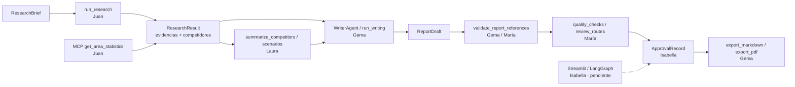

<p align="center">
  
</p>

<h1 align="center">FitFamily</h1>

<p align="center">
  <strong>Plataforma de investigación de mercado para un gimnasio con ludoteca · El Cañaveral, Madrid</strong><br>
  <sub>Market research platform for a gym with a playroom · El Cañaveral, Madrid</sub>
</p>

<p align="center">
  
  
  <a href="https://github.com/Isabela-Tellez/FitFamily/actions/workflows/ci.yml"></a>
  
  
  
</p>

<p align="center"><sub>Español · <a href="#english-version">English version ↓</a></sub></p>

## Qué es FitFamily

FitFamily evalúa la viabilidad de abrir un gimnasio con ludoteca en **El Cañaveral** (Vicálvaro, Madrid). Cubre el recorrido completo del producto: investigación con evidencias trazables, análisis de competidores y escenarios, redacción del informe, revisión crítica y exportación aprobada en Markdown o PDF.

El principio de diseño es la trazabilidad: cada dato del informe apunta a una evidencia (`evidence_id`) o queda explícitamente como no disponible. Si un valor no se ha observado, se mantiene `null`; `null` significa "no disponible", nunca cero.

## Problema que resuelve

Decidir si abrir un gimnasio con ludoteca exige datos locales verificables sobre población, hogares, competencia, precios y servicios. Hoy esa información suele estar dispersa, desactualizada o mezclada con suposiciones, lo que dificulta justificar la inversión y detectar lo que todavía no se sabe.

FitFamily separa tres cosas que suelen confundirse:

1. **Dato observado** — con fuente, fecha y `evidence_id`.
2. **Dato no disponible** — `null`, nunca un valor inventado.
3. **Estimación** — escenario explícito, con supuestos visibles.

## Equipo y roles

| Persona | Rol | Módulos principales | Estado |
|---|---|---|---|
| **1 · Juan** | Investigación, fuentes y MCP | `src/agents/researcher.py`, `src/tools/`, `src/mcp/` | ✅ Funcional |
| **2 · Laura** | Análisis de mercado y escenarios | `src/analysis/market_analysis.py`, `src/analysis/scenarios.py` | ✅ Funcional |
| **3 · Gema** | Redacción, informes y automatización | `src/agents/writer_agent.py`, `src/agents/writer_llm.py`, `src/reporting/`, `src/automation/` | ✅ Funcional |
| **4 · María** | Revisión, validación y seguridad | `src/review/`, `src/graph/review_routes.py` | ✅ Funcional |
| **5 · Isabella** | Streamlit, LangGraph y aprobación humana | UI y orquestación global | ⚠️ Pendiente |

El detalle de interfaces, contratos y responsabilidades está en [docs/arquitectura-modulos.md](docs/arquitectura-modulos.md).

## Caso de uso

Una persona quiere responder: *¿es viable abrir un gimnasio con ludoteca en El Cañaveral?* El producto acompaña el recorrido completo:

1. **Investigación (Juan).** Se define un `ResearchBrief` y `run_research` devuelve un `ResearchResult` con evidencias, competidores, fuentes descubiertas y preguntas sin resolver.
2. **Análisis (Laura).** `summarize_competitors` resume precios, servicios y ludoteca a partir del registro de competidores; `scenarios` calcula el punto de equilibrio con supuestos explícitos.
3. **Redacción (Gema).** `WriterAgent` genera un `ReportDraft` determinista; `build_report(..., use_llm=True)` usa CrewAI + Groq para la versión con LLM.
4. **Revisión (María).** `validate_report_references` rechaza evidencias inexistentes; `quality_checks` y `review_routes` aplican control de calidad y priorizan correcciones.
5. **Aprobación y exportación (Gema + Isabella).** Un `ApprovalRecord` autoriza el borrador; `export_markdown` y `export_pdf` publican el informe con huella de contenido y escritura atómica.
6. **Interfaz (Isabella, pendiente).** Streamlit y LangGraph conectarán el flujo completo con aprobación humana y estado compartido.

## Demo rápida

Comprueba el servidor MCP local por `stdio`, sin claves ni conexión a internet:

```bash
python -m src.mcp.client
```

El cliente arranca el servidor, descubre la herramienta `get_area_statistics` y consulta indicadores de El Cañaveral.

También puedes ejecutar una investigación desde Python. Esta ruta sí requiere red:

```python
from src.agents.researcher import run_research
from src.schemas import ResearchBrief

brief = ResearchBrief(
    business_type="gimnasio con ludoteca",
    location="Madrid",
    study_area="El Cañaveral",
    questions=["precios", "servicios", "horarios"],
    search_limits={"max_results": 5},
    missing_variables=["renta media por hogar"],
)

result = run_research(brief)
print(result.model_dump_json(indent=2))
```

Genera un borrador validado y su Markdown:

```python
from src.reporting.report_builder import build_report, build_report_markdown

draft = build_report(brief, result)                 # determinista
draft_llm = build_report(brief, result, use_llm=True)  # CrewAI + Groq
markdown = build_report_markdown(brief, result)
```

Exporta solo con aprobación:

```python
from src.automation.exporter import export_markdown, export_pdf

export_markdown(draft, approval=approval_record, run_id="run-001", output_dir="exports")
export_pdf(draft, approval=approval_record, run_id="run-001", output_dir="exports")
```

## Arquitectura



Investigación y MCP son rutas separadas que convergen en el análisis. La exportación nunca ocurre sin un `ApprovalRecord` válido para el mismo borrador. El mapa detallado de módulos, interfaces y piezas pendientes está en [docs/arquitectura-modulos.md](docs/arquitectura-modulos.md).

## Estado actual

| Área | Estado |
|---|---|
| Investigación web y búsqueda de competidores | ✅ Funcional |
| Evidencias con IDs deterministas y límites de búsqueda | ✅ Funcional |
| Descubrimiento de fuentes para variables pendientes | ✅ Funcional |
| Servidor MCP con 13 indicadores locales | ✅ Funcional |
| Registro de competidores desde el censo municipal | ✅ Funcional; preparación offline |
| Análisis descriptivo y escenarios de punto de equilibrio | ✅ Funcional |
| Borrador determinista (`WriterAgent`) | ✅ Funcional |
| Borrador con LLM (`run_writing`, CrewAI + Groq) | ✅ Funcional (`use_llm=True`) |
| Trazabilidad del borrador (`draft_id`, `version`, `claims`) | ✅ Funcional |
| Validación de referencias y control de calidad | ✅ Funcional |
| Exportación Markdown y PDF con `ApprovalRecord` | ✅ Funcional |
| Trazas LangSmith | ✅ Configuración opcional (`.env.example`) |
| UI Streamlit / orquestación LangGraph | ⚠️ Pendiente (Isabella) |
| CLI u orquestador único | ⚠️ Pendiente |

## Puesta en marcha

Requisitos: Python 3.13, Git y conexión a internet para las herramientas web.

```bash
git clone https://github.com/Isabela-Tellez/FitFamily.git
cd FitFamily
python -m venv .venv
```

Windows PowerShell:

```powershell
.\.venv\Scripts\Activate.ps1
```

macOS / Linux:

```bash
source .venv/bin/activate
```

Instala las dependencias:

```bash
python -m pip install --upgrade pip
python -m pip install -r requirements.txt
```

Variables de entorno (todas opcionales para el flujo determinista):

| Variable | Uso |
|---|---|
| `GROQ_API_KEY` | Redacción con LLM (`use_llm=True` / `run_writing`) |
| `WRITER_LLM_MODEL` | Modelo de Groq; por defecto `groq/openai/gpt-oss-120b` |
| `TAVILY_API_KEY` | Búsqueda web alternativa; sin ella se usa DuckDuckGo (`ddgs`) |
| `LANGCHAIN_TRACING_V2`, `LANGCHAIN_PROJECT`, `LANGSMITH_API_KEY` | Trazas opcionales en LangSmith |

El archivo [`.env.example`](.env.example) documenta los nombres; no guardes claves reales en el repositorio.

`pyproj`, `reportlab`, `pandas`, `crewai` y `litellm` se instalan con `requirements.txt`. `pyproj` se usa para convertir coordenadas UTM a WGS84 en el registro de competidores.

## Datos y método

| Fuente | Uso |
|---|---|
| Padrón Municipal y fichero de hogares | Población, hogares, tamaño medio y hogares con menores |
| Censo de Locales y Actividades | Locales, epígrafes, licencias y coordenadas |
| Webs de competidores | Precios, servicios y ludoteca, solo con evidencia vinculada a la dirección oficial |

El MCP publica **13 indicadores**: 11 con valor verificado y 2 no disponibles (`families_with_children` y `gyms_with_ludoteca`). Los períodos se mantienen separados: la población actual es de octubre de 2026 y los hogares de enero de 2025. No se mezclan para calcular ratios.

El registro de competidores se genera con `data/raw/extract_competitor_registry.py` y se guarda en `data/processed/competitor_registry.json` y `.csv`. Las descargas grandes y la caché están ignoradas por Git.

## Estructura del repositorio

```text
src/agents/       Investigación y redacción (determinista + LLM)
src/tools/        Búsqueda, lectura web, competidores y descubrimiento de fuentes
src/mcp/          Servidor y cliente MCP
src/analysis/     Análisis descriptivo y escenarios
src/reporting/    Modelo, construcción y renderizado del informe (Markdown/PDF)
src/automation/   Aprobación y exportación atómica de informes
src/review/       Validación de referencias y control de calidad
src/graph/        Rutas de revisión y priorización de correcciones
data/raw/         Scripts de preparación y fuentes documentadas
data/processed/   Artefactos generados, como el registro de competidores
docs/             Contratos, auditoría de fuentes, arquitectura y guías por módulo
tests/            Pruebas deterministas y de integración
assets/           Identidad visual del proyecto
```

## Pruebas y calidad

```bash
python -m pytest -q
python -m compileall -q src tests data/raw
```

**273 pruebas pasan** con el entorno de `requirements.txt` (incluye `pyproj`). Las pruebas del investigador sustituyen las herramientas web por respuestas controladas; el cliente MCP arranca un subproceso local. Los warnings de deprecación de CrewAI no son fallos.

El workflow [`.github/workflows/ci.yml`](.github/workflows/ci.yml) ejecuta `compileall` y `pytest` con Python 3.13 en cada push y pull request. No hay linter ni comprobador de tipos configurados.

## Documentación

- [Mapa de módulos e interfaces](docs/arquitectura-modulos.md)
- [Módulo de investigación](docs/research-module.md)
- [Implementación de la investigación](docs/research-implementation.md)
- [Auditoría de fuentes de datos](docs/auditoria-fuentes-datos.md)
- [Changelog de investigación](docs/research-changelog.md)
- [Exportación de informes y PDF](docs/report-export.md)
- [Redactor con LLM (CrewAI + Groq)](docs/writer-llm.md)
- [Pendiente: renta media por hogar (INE)](docs/pendiente-renta-ine.md)

## Limitaciones

- No existe todavía un flujo único que encadene investigación → análisis → informe → exportación; Streamlit, LangGraph y la CLI están pendientes (Isabella).
- `ApprovalRecord` y la exportación ya funcionan, pero la aprobación humana desde interfaz aún no tiene UI.
- `WriterAgent.create_draft()` no conecta automáticamente con `summarize_competitors`; requiere un adaptador explícito.
- `coverage_percentage` sigue siendo `0.0`; no hay evaluación LLM de cobertura.
- El MCP y el registro de competidores usan datos preparados offline; no se actualizan solos.
- Los registros municipales son administrativos y pueden contener inconsistencias. Un epígrafe declarado no garantiza que el negocio esté operativo.
- FitFamily es un **MVP funcional de investigación**, no una herramienta de decisión financiera.

## Licencia

MIT. Consulta [LICENSE](LICENSE).

<details>
<summary id="english-version"><strong>English version</strong></summary>

### Overview

FitFamily assesses the viability of opening a gym with a playroom in **El Cañaveral** (Vicálvaro, Madrid). It covers the full product path: research with traceable evidence, competitor and scenario analysis, report writing, critical review, and approved Markdown/PDF export.

**Design principle:** every report value points to an `evidence_id` or is explicitly unavailable. If a value has not been observed, it stays `null`. `null` means "not available", never zero.

### Team and roles

| Person | Role | Main modules | Status |
|---|---|---|---|
| **1 · Juan** | Research, sources and MCP | `src/agents/researcher.py`, `src/tools/`, `src/mcp/` | ✅ Working |
| **2 · Laura** | Market analysis and scenarios | `src/analysis/` | ✅ Working |
| **3 · Gema** | Writing, reports and automation | `src/agents/writer_agent.py`, `src/agents/writer_llm.py`, `src/reporting/`, `src/automation/` | ✅ Working |
| **4 · María** | Review, validation and security | `src/review/`, `src/graph/review_routes.py` | ✅ Working |
| **5 · Isabella** | Streamlit, LangGraph and human approval | UI and global orchestration | ⚠️ Pending |

### Use case

1. **Research (Juan).** `run_research(brief)` returns a `ResearchResult` with evidence, competitors, discovered sources and unresolved questions.
2. **Analysis (Laura).** `summarize_competitors` summarizes prices, services and playroom data; `scenarios` calculates break-even with explicit assumptions.
3. **Writing (Gema).** `WriterAgent` creates a deterministic `ReportDraft`; `build_report(..., use_llm=True)` uses CrewAI + Groq.
4. **Review (María).** `validate_report_references`, `quality_checks` and `review_routes` reject invalid references and prioritize corrections.
5. **Approval and export (Gema + Isabella).** An `ApprovalRecord` authorizes the draft; `export_markdown` and `export_pdf` publish it with a content fingerprint and atomic writes.
6. **UI (Isabella, pending).** Streamlit and LangGraph will connect the full flow with human approval and shared state.

### Quick demo

Check the local MCP server over `stdio`, without API keys or internet access:

```bash
python -m src.mcp.client
```

Run research from Python (requires network):

```python
from src.agents.researcher import run_research
from src.schemas import ResearchBrief

brief = ResearchBrief(
    business_type="gym with playroom",
    location="Madrid",
    study_area="El Cañaveral",
    questions=["prices", "services", "opening hours"],
    search_limits={"max_results": 5},
    missing_variables=["average household income"],
)

result = run_research(brief)
print(result.model_dump_json(indent=2))
```

Build and export a validated report:

```python
from src.reporting.report_builder import build_report, build_report_markdown
from src.automation.exporter import export_markdown, export_pdf

draft = build_report(brief, result)
draft_llm = build_report(brief, result, use_llm=True)
markdown = build_report_markdown(brief, result)

export_markdown(draft, approval=approval_record, run_id="run-001", output_dir="exports")
export_pdf(draft, approval=approval_record, run_id="run-001", output_dir="exports")
```

### Current status

| Area | Status |
|---|---|
| Web research and competitor search | ✅ Working |
| Deterministic evidence IDs and search limits | ✅ Working |
| Source discovery for missing variables | ✅ Working |
| MCP server with 13 local indicators | ✅ Working |
| Competitor registry from municipal open data | ✅ Working; offline preparation |
| Descriptive analysis and break-even scenarios | ✅ Working |
| Deterministic report draft (`WriterAgent`) | ✅ Working |
| LLM report draft (`run_writing`, CrewAI + Groq) | ✅ Working (`use_llm=True`) |
| Draft traceability (`draft_id`, `version`, `claims`) | ✅ Working |
| Reference validation and quality checks | ✅ Working |
| Markdown and PDF export with `ApprovalRecord` | ✅ Working |
| LangSmith tracing | ✅ Optional configuration (`.env.example`) |
| Streamlit UI / LangGraph orchestration | ⚠️ Pending (Isabella) |
| CLI or single orchestrator | ⚠️ Pending |

### Setup

Requirements: Python 3.13, Git, and internet access for the web tools.

```bash
git clone https://github.com/Isabela-Tellez/FitFamily.git
cd FitFamily
python -m venv .venv
```

Windows PowerShell:

```powershell
.\.venv\Scripts\Activate.ps1
```

macOS / Linux:

```bash
source .venv/bin/activate
```

Install dependencies:

```bash
python -m pip install --upgrade pip
python -m pip install -r requirements.txt
```

Environment variables (all optional for the deterministic flow): `GROQ_API_KEY`, `WRITER_LLM_MODEL`, `TAVILY_API_KEY`, `LANGCHAIN_TRACING_V2`, `LANGCHAIN_PROJECT`, `LANGSMITH_API_KEY`. See [`.env.example`](.env.example); never commit real keys.

### Data and method

| Source | Purpose |
|---|---|
| Municipal register and household file | Population, households, average household size and households with minors |
| Local premises and activities census | Premises, economic activities, licences and coordinates |
| Competitor websites | Prices, services and playroom evidence, only when tied to the official address |

The MCP exposes **13 indicators**: 11 verified values and 2 unavailable ones (`families_with_children` and `gyms_with_ludoteca`). Reference periods are kept separate: current population is from October 2026, while household data is from January 2025. They are not mixed to compute ratios.

The competitor registry is generated by `data/raw/extract_competitor_registry.py` and stored in `data/processed/competitor_registry.json` and `.csv`. Large downloads and caches are ignored by Git.

### Tests

```bash
python -m pytest -q
python -m compileall -q src tests data/raw
```

**273 tests pass** with the `requirements.txt` environment (including `pyproj`). Researcher tests replace web tools with controlled responses; the MCP client starts a local subprocess. CrewAI deprecation warnings are not failures.

The workflow [`.github/workflows/ci.yml`](.github/workflows/ci.yml) runs `compileall` and `pytest` on Python 3.13 for every push and pull request. No linter or type checker is configured.

### Documentation

- [Module map](docs/arquitectura-modulos.md)
- [Research module](docs/research-module.md)
- [Research implementation](docs/research-implementation.md)
- [Data source audit](docs/auditoria-fuentes-datos.md)
- [Research changelog](docs/research-changelog.md)
- [Report export and PDF](docs/report-export.md)
- [LLM writer (CrewAI + Groq)](docs/writer-llm.md)
- [Pending: average household income (INE)](docs/pendiente-renta-ine.md)

### Limitations

- There is no single research → analysis → report → export pipeline yet; Streamlit, LangGraph and the CLI are pending (Isabella).
- `ApprovalRecord` and export already work, but human approval has no UI yet.
- `WriterAgent.create_draft()` does not automatically connect to `summarize_competitors`; it needs an explicit adapter.
- `coverage_percentage` remains `0.0`; there is no LLM coverage evaluation.
- The MCP and competitor registry use offline prepared data and do not update themselves.
- Municipal records are administrative and may contain inconsistencies. A declared activity does not guarantee that a business is operating.
- FitFamily is a **functional research MVP**, not a financial decision tool.

### License

MIT. See [LICENSE](LICENSE).

</details>
