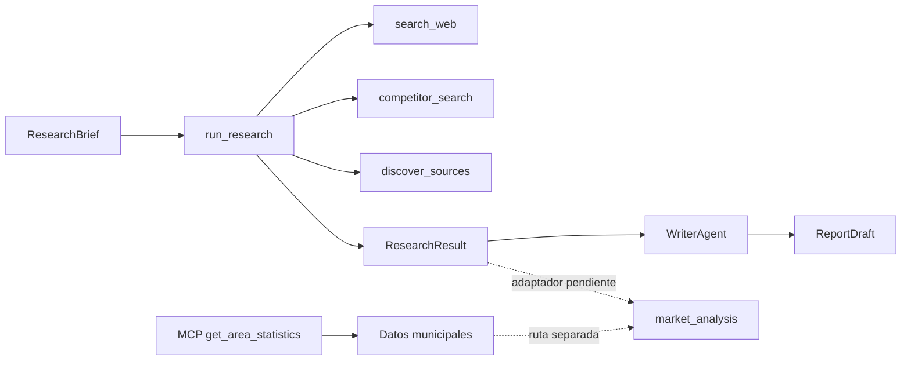

<p align="center">
  
</p>

<h1 align="center">FitFamily</h1>

<p align="center">
  <strong>Investigación de mercado para un gimnasio con ludoteca · El Cañaveral, Madrid</strong><br>
  <sub>Market research for a gym with a playroom · El Cañaveral, Madrid</sub>
</p>

<p align="center">
  
  
  <a href=".github/workflows/ci.yml"></a>
  
  
  
</p>

<p align="center"><sub>Español · <a href="#english-version">English version ↓</a></sub></p>

---

FitFamily reúne datos municipales verificables, búsqueda web con evidencia trazable y contratos de análisis y redacción para estudiar la viabilidad de un gimnasio con ludoteca en **El Cañaveral** (Vicálvaro, Madrid).

El repositorio **todavía no es un producto de extremo a extremo**: no hay CLI, interfaz de usuario ni orquestación LLM completa. Lo que sí existe es una base funcional y auditable para investigar competidores, consultar indicadores locales y generar un borrador de informe sin inventar datos ausentes.

> **Principio de diseño:** un dato que no se ha observado se queda en `null`. Un `null` significa "no disponible", nunca cero, y una fuente no se considera verificada solo porque aparezca en una búsqueda.

## Problema que resuelve

Decidir si abrir un gimnasio con ludoteca exige datos locales verificables sobre población, hogares, competencia, precios y servicios. Hoy esa información suele estar dispersa, desactualizada o mezclada con suposiciones, lo que dificulta justificar la inversión y detectar lo que todavía no se sabe.

## Demo rápida

Comprueba el servidor MCP local por `stdio`, sin claves ni conexión a internet:

```bash
python -m src.mcp.client
```

El cliente arranca el servidor, descubre la herramienta `get_area_statistics` y consulta indicadores de El Cañaveral.

También puedes ejecutar una investigación desde Python. Esta ruta sí requiere red:

```python
from src.agents.researcher import run_research
from src.schemas import ResearchBrief

brief = ResearchBrief(
    business_type="gimnasio con ludoteca",
    location="Madrid",
    study_area="El Cañaveral",
    questions=["precios", "servicios", "horarios"],
    search_limits={"max_results": 5},
    missing_variables=["renta media por hogar"],
)

result = run_research(brief)
print(result.model_dump_json(indent=2))
```

## Arquitectura



La investigación y el MCP son dos rutas separadas. El análisis de mercado existe como contrato, pero todavía no consume automáticamente un `ResearchResult`. El mapa detallado de módulos, interfaces y piezas pendientes está en [docs/arquitectura-modulos.md](docs/arquitectura-modulos.md).

## Estado actual

| Área | Estado |
|---|---|
| Investigación web y búsqueda de competidores | Funcional |
| Evidencias con IDs deterministas y límites de búsqueda | Funcional |
| Descubrimiento de fuentes para variables pendientes | Funcional |
| Servidor MCP con 13 indicadores locales | Funcional |
| Registro de competidores desde el censo municipal | Funcional; preparación offline |
| Análisis descriptivo y borrador de informe | Contratos funcionales |
| Trazabilidad del borrador (`draft_id`, `version`, `claims`) | Funcional |
| CLI, orquestador, exportación, UI y ejecución LLM completa | Pendiente |

## Puesta en marcha

Requisitos: Python 3.13, Git y conexión a internet para las herramientas web.

```bash
git clone https://github.com/Isabela-Tellez/FitFamily.git
cd FitFamily
python -m venv .venv
```

Windows PowerShell:

```powershell
.\.venv\Scripts\Activate.ps1
```

macOS / Linux:

```bash
source .venv/bin/activate
```

Instala las dependencias:

```bash
python -m pip install --upgrade pip
python -m pip install -r requirements.txt
```

`TAVILY_API_KEY` es opcional. Si no está definida, `search_web` usa DuckDuckGo mediante `ddgs`. El archivo [`.env.example`](.env.example) documenta la variable; no guardes claves reales en el repositorio.

Para convertir coordenadas UTM a WGS84 hace falta `pyproj`, que es una dependencia opcional y no se instala con `requirements.txt`. Sin ella, el registro funciona pero deja `latitude` y `longitude` en `None`. Si necesitas la conversión, instálala con `python -m pip install pyproj`.

## Datos y método

| Fuente | Uso |
|---|---|
| Padrón Municipal y fichero de hogares | Población, hogares, tamaño medio y hogares con menores |
| Censo de Locales y Actividades | Locales, epígrafes, licencias y coordenadas |
| Webs de competidores | Precios, servicios y ludoteca, solo con evidencia vinculada a la dirección oficial |

El MCP publica **13 indicadores**: 11 con valor verificado y 2 no disponibles (`families_with_children` y `gyms_with_ludoteca`). Los períodos se mantienen separados: la población actual es de octubre de 2026 y los hogares de enero de 2025. No se mezclan para calcular ratios.

El registro de competidores se genera con `data/raw/extract_competitor_registry.py` y se guarda en `data/processed/competitor_registry.json` y `.csv`. Las descargas grandes y la caché están ignoradas por Git.

## Estructura del repositorio

```text
src/agents/       Investigación y redacción
src/tools/        Búsqueda, lectura web, competidores y descubrimiento de fuentes
src/mcp/          Servidor y cliente MCP
src/analysis/     Análisis descriptivo de mercado
src/reporting/    Modelo del borrador de informe
data/raw/         Scripts de preparación y fuentes documentadas
data/processed/   Artefactos generados, como el registro de competidores
docs/             Contratos, auditoría de fuentes y mapa de arquitectura
tests/            Pruebas deterministas y de integración
assets/           Identidad visual del proyecto
```

## Pruebas y calidad

```bash
python -m pytest -q
python -m compileall -q src tests data/raw
```

En un entorno limpio sin `pyproj`: **192 pruebas pasan y 1 se omite** (la conversión opcional de coordenadas). Con `pyproj` instalado: **193 pasan**. Las pruebas del investigador sustituyen las herramientas web por respuestas controladas; el cliente MCP arranca un subproceso local.

El workflow [`.github/workflows/ci.yml`](.github/workflows/ci.yml) ejecuta `compileall` y `pytest` con Python 3.13. **Su primera ejecución remota aún está pendiente**, así que este README no afirma que GitHub Actions haya pasado. No hay linter ni comprobador de tipos configurados.

## Documentación

- [Mapa de módulos e interfaces](docs/arquitectura-modulos.md)
- [Módulo de investigación](docs/research-module.md)
- [Implementación de la investigación](docs/research-implementation.md)
- [Auditoría de fuentes de datos](docs/auditoria-fuentes-datos.md)
- [Changelog de investigación](docs/research-changelog.md)

## Limitaciones

- No existe un flujo único que encadene investigación → análisis → informe → exportación.
- `coverage_percentage` sigue siendo `0.0`; no hay evaluación LLM de cobertura.
- El MCP y el registro de competidores usan datos preparados offline; no se actualizan solos.
- Los registros municipales son administrativos y pueden contener inconsistencias. Un epígrafe declarado no garantiza que el negocio esté operativo.
- El repositorio es un prototipo de investigación, no una herramienta de decisión financiera.

## Licencia

MIT. Consulta [LICENSE](LICENSE).

<details>
<summary id="english-version"><strong>English version</strong></summary>

### Overview

FitFamily is a market-research project for assessing a gym with a playroom in **El Cañaveral** (Vicálvaro, Madrid). It combines verifiable municipal data, web research with traceable evidence, and clear contracts for analysis and report drafting.

This repository is **not yet an end-to-end product**: there is no CLI, user interface, or complete LLM orchestration. What exists is a functional, auditable base for researching competitors, querying local indicators, and producing a draft report without inventing missing data.

> **Design principle:** if a value has not been observed, it stays `null`. `null` means "not available", never zero. A source is not considered verified just because it appears in a search result.

### Problem it solves

Deciding whether to open a gym with a playroom requires verifiable local data about population, households, competitors, prices and services. Today that information is often scattered, outdated or mixed with assumptions, which makes it hard to justify the investment and to see what is still unknown.

### Quick demo

Check the local MCP server over `stdio`, without API keys or internet access:

```bash
python -m src.mcp.client
```

The client starts the server, discovers the `get_area_statistics` tool, and queries indicators for El Cañaveral.

You can also run research from Python. This path requires network access:

```python
from src.agents.researcher import run_research
from src.schemas import ResearchBrief

brief = ResearchBrief(
    business_type="gym with playroom",
    location="Madrid",
    study_area="El Cañaveral",
    questions=["prices", "services", "opening hours"],
    search_limits={"max_results": 5},
    missing_variables=["average household income"],
)

result = run_research(brief)
print(result.model_dump_json(indent=2))
```

### Architecture

Research and MCP are separate paths. The research flow goes from `ResearchBrief` to `ResearchResult`, then to a `ReportDraft` through `WriterAgent`. Market analysis exists as a contract, but it does not yet consume a `ResearchResult` automatically. The MCP server exposes local municipal indicators independently. See the [module map](docs/arquitectura-modulos.md) for the full interface inventory (documentation in Spanish).

### Current status

| Area | Status |
|---|---|
| Web research and competitor search | Working |
| Deterministic evidence IDs and search limits | Working |
| Source discovery for missing variables | Working |
| MCP server with 13 local indicators | Working |
| Competitor registry from municipal open data | Working; offline preparation |
| Descriptive analysis and report draft | Working contracts |
| Report draft traceability (`draft_id`, `version`, `claims`) | Working |
| CLI, orchestrator, export, UI and full LLM execution | Pending |

### Setup

Requirements: Python 3.13, Git, and internet access for the web tools.

```bash
git clone https://github.com/Isabela-Tellez/FitFamily.git
cd FitFamily
python -m venv .venv
```

Windows PowerShell:

```powershell
.\.venv\Scripts\Activate.ps1
```

macOS / Linux:

```bash
source .venv/bin/activate
```

Install the dependencies:

```bash
python -m pip install --upgrade pip
python -m pip install -r requirements.txt
```

`TAVILY_API_KEY` is optional. Without it, `search_web` uses DuckDuckGo through `ddgs`. See [`.env.example`](.env.example); never commit real keys.

`pyproj` is optional and is not installed by `requirements.txt`. It is only needed to convert UTM coordinates to WGS84; without it, the registry still works but `latitude` and `longitude` remain `None`. Install it with `python -m pip install pyproj` if you need the conversion.

### Data and method

| Source | Purpose |
|---|---|
| Municipal register and household file | Population, households, average household size and households with minors |
| Local premises and activities census | Premises, economic activities, licences and coordinates |
| Competitor websites | Prices, services and playroom evidence, only when tied to the official address |

The MCP exposes **13 indicators**: 11 verified values and 2 unavailable ones (`families_with_children` and `gyms_with_ludoteca`). Reference periods are kept separate: current population is from October 2026, while household data is from January 2025. They are not mixed to compute ratios.

The competitor registry is generated by `data/raw/extract_competitor_registry.py` and stored in `data/processed/competitor_registry.json` and `.csv`. Large downloads and caches are ignored by Git.

### Tests

```bash
python -m pytest -q
python -m compileall -q src tests data/raw
```

In a clean environment without `pyproj`: **192 tests pass and 1 is skipped** (the optional coordinate conversion). With `pyproj` installed: **193 pass**. Researcher tests replace web tools with controlled responses; the MCP client starts a local subprocess.

The workflow [`.github/workflows/ci.yml`](.github/workflows/ci.yml) runs `compileall` and `pytest` on Python 3.13. **Its first remote run is still pending**, so this README does not claim that GitHub Actions has passed. No linter or type checker is configured.

### Documentation

- [Module map](docs/arquitectura-modulos.md)
- [Research module](docs/research-module.md)
- [Research implementation](docs/research-implementation.md)
- [Data source audit](docs/auditoria-fuentes-datos.md)
- [Research changelog](docs/research-changelog.md)

### Limitations

- There is no single research → analysis → report → export pipeline.
- `coverage_percentage` remains `0.0`; there is no LLM coverage evaluation.
- The MCP and the competitor registry use offline prepared data and do not update themselves.
- Municipal records are administrative and may contain inconsistencies. A declared activity does not guarantee that a business is operating.
- This is a research prototype, not a financial decision tool.

### License

MIT. See [LICENSE](LICENSE).

</details>
