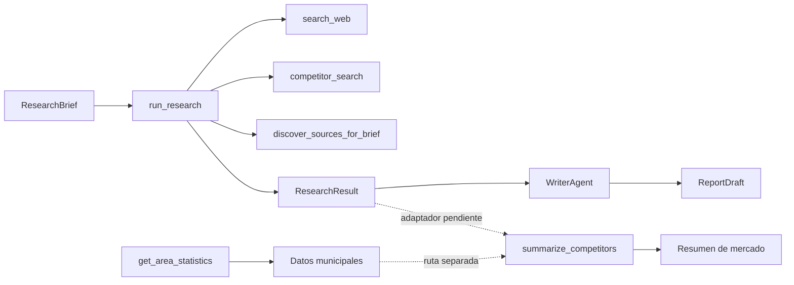

# Mapa de módulos e interfaces

Estado descrito: 21/10/2026. Incluye el PR #5 (`fix/respect-search-limits`) y el trabajo de infraestructura, pruebas y CI. Este documento describe el código actual, no un producto terminado.

## Flujo actual



El flujo implementado llega de `ResearchBrief` a `ResearchResult` y de ahí a un borrador en memoria. `summarize_competitors` existe, pero no hay un adaptador automático desde `ResearchResult`. El MCP es una ruta de datos independiente. No hay CLI ni orquestador que una investigación, análisis, informe y salida.

## Módulos implementados

| Área | Archivo | Interfaz principal | Estado |
|---|---|---|---|
| Contratos | `src/schemas.py` | `ResearchBrief`, `ResearchResult`, `Evidence`, `Competitor` | Implementado |
| Investigación | `src/agents/researcher.py` | `run_research(brief, context=None) -> ResearchResult` | Implementado; ejecuta herramientas sin LLM |
| Búsqueda web | `src/tools/search_web.py` | `search_web(query, max_results=10) -> list[SearchResult]` | Implementado; requiere red |
| Lectura web | `src/tools/read_web_page.py` | `read_web_page(url) -> PageReadResult` | Implementado; requiere red |
| Competidores web | `src/tools/competitor_search.py` | `competitor_search(params) -> dict` | Implementado; requiere red |
| Descubrimiento de fuentes | `src/tools/source_discovery.py` | `discover_sources(variable, area, max_results_per_query=5)` | Implementado; requiere red |
| Registro oficial | `src/tools/competitor_registry.py` | `build_competitor_registry()`, `enrich_competitor_from_web()`, `to_dataframe()` | Implementado; datos municipales + web opcional |
| IDs de evidencia | `src/tools/evidence_ids.py` | `stable_evidence_id(prefix, *parts, length=16)` | Implementado; SHA-256 |
| Servidor MCP | `src/mcp/server.py` | `get_area_statistics(area_id, indicators=None)`, `run_mcp_server()` | Implementado; datos locales |
| Cliente MCP | `src/mcp/client.py` | `connect_mcp()`, `list_mcp_tools()`, `call_area_statistics()` | Implementado |
| Análisis | `src/analysis/market_analysis.py` | `summarize_competitors(data: pandas.DataFrame) -> dict` | Implementado; requiere DataFrame |
| Redacción | `src/agents/writer_agent.py` | `WriterAgent.create_draft(brief, research_result) -> ReportDraft` | Implementado; plantilla sin LLM |
| Modelo de informe | `src/reporting/models.py` | `ReportDraft(title, study_area, sections, sources, limitations)` | Implementado; sin exportación |
| Datos offline | `data/raw/extract_households.py`, `extract_censo_locales.py`, `extract_competitor_registry.py` | Scripts de preparación reproducibles | Implementado; no son runtime |
| Fuentes | `data/sources.json`, `data/processed/competitor_registry.*` | Catálogo y artefacto del registro | Implementado |
| CI | `.github/workflows/ci.yml` | `compileall` + `pytest` en Python 3.13 | Versionado; primera ejecución remota pendiente |

## Contratos e interfaces

### `ResearchBrief` → `ResearchResult`

`run_research(brief, context=None)` valida el brief, ejecuta las herramientas y devuelve un `ResearchResult` con:

- `evidences`: evidencias de la búsqueda, del competidor y del descubrimiento de fuentes.
- `competitors`: competidores identificados.
- `coverage_percentage`: hoy vale `0.0`; no hay evaluación LLM de cobertura.
- `unresolved_questions`: lista inicial de preguntas del brief; hoy no se recalcula qué se ha respondido.
- `search_performed` y `notes`: resumen y limitaciones de la ejecución.

`ResearchBrief.search_limits.max_results` se respeta mediante `resolve_max_results`: por defecto `5`, con mínimo `1` y máximo `20`, el mismo límite que aceptan las herramientas. Si el brief declara `missing_variables`, se ejecuta una pasada de descubrimiento de fuentes y se registran candidatos y descartes.

Las evidencias usan IDs deterministas con SHA-256, de modo que el mismo hecho conserva el mismo identificador entre ejecuciones. `ResearchResult.evidences` ya incluye las evidencias de cada competidor; un consumidor que recorra ambas listas debe deduplicar.

### Herramientas web

- `search_web` usa Tavily si existe `TAVILY_API_KEY`; si no, usa DuckDuckGo con `ddgs`. El máximo efectivo es 20 resultados.
- `read_web_page` acepta solo HTTP/HTTPS, valida redirecciones, bloquea destinos privados/locales y limita tamaño y tiempo de respuesta.
- `competitor_search` devuelve `competitors`, `evidences`, `search_summary` y `unresolved_questions`. Extrae precios sin convertirlos de periodo y conserva la evidencia de cada dato.
- `discover_sources` distingue estados `discovered`, `accessible`, `extracted`, `validated` y `rejected`. Una fuente no se considera verificada solo por aparecer en la búsqueda.

### Registro de competidores

`data/raw/extract_competitor_registry.py` une tres recursos oficiales del Censo de Locales y Actividades del Ayuntamiento de Madrid:

- locales: identificador, dirección, código postal y coordenadas;
- actividades: epígrafes económicos declarados;
- licencias: referencia y situación administrativa.

`build_competitor_registry` conserva solo datos oficiales y genera evidencias por campo. `enrich_competitor_from_web` añade precios y ludoteca únicamente cuando la página puede vincularse a la dirección oficial; una página de otro negocio, una vivienda o una opinión no se usa como evidencia. El resultado se publica en `data/processed/competitor_registry.json` y `.csv`.

La conversión de coordenadas UTM 30N a WGS84 usa `pyproj`, que es **opcional**: si no está instalado, `latitude` y `longitude` quedan en `None` y el registro sigue siendo válido. Las coordenadas `0,0` o fuera del ámbito de la Comunidad de Madrid también se consideran no disponibles. La prueba de conversión se omite si falta `pyproj`.

### MCP

El servidor publica una única herramienta, `get_area_statistics(area_id, indicators=None)`. En el estado actual publica **13 indicadores**:

- 11 con valor verificado: `population_total`, `population_total_2025`, `households_total`, `average_household_size`, `population_under_20_share`, `businesses_open`, `households_with_minors`, `gyms_registered`, `sports_recreation_venues`, `childrens_play_venues`, `community_pools`.
- 2 no disponibles: `families_with_children` y `gyms_with_ludoteca`.

`null` significa "no disponible", nunca cero. `families_with_children` no se publica a nivel de barrio porque el Padrón mide hogares, no familias; `households_with_minors` es la aproximación más cercana y es un mínimo. `gyms_with_ludoteca` no se puede derivar de los epígrafes del censo; requiere confirmación centro a centro.

El cliente se usa para comprobar el protocolo:

```bash
python -m src.mcp.client
```

### Análisis y redacción

`summarize_competitors` requiere un `pandas.DataFrame` con estas columnas:

- `gym_name`
- `monthly_price_eur`
- `has_playroom`

Devuelve conteos de competidores, precios conocidos, precio medio mensual y respuestas de ludoteca (`sí`, `no`, desconocidas).

`WriterAgent.create_draft` consume directamente un `ResearchResult` y produce un `ReportDraft` en memoria. No calcula viabilidad financiera, no usa LLM y no escribe archivos.

## Piezas que faltan para el flujo de extremo a extremo

1. **Orquestador/CLI**: no existe `src/main.py` ni un comando que encadene brief → investigación → análisis → borrador → salida.
2. **Adaptador `ResearchResult` → DataFrame**: `summarize_competitors` no consume directamente `ResearchResult.competitors`. Hay que definir cómo obtener `monthly_price_eur` desde `Competitor.tariffs` y `has_playroom` desde evidencias, sin inferir datos ausentes.
3. **Exportación del informe**: `ReportDraft` no tiene serializador ni escritura en `reports/`.
4. **Orquestación LLM**: `build_researcher` y `build_research_task` construyen objetos CrewAI, pero `run_research` ejecuta las herramientas directamente. No hay una `Crew` que ejecute el ciclo completo.
5. **Interfaz de usuario y capas de producto**: `automation`, `graph`, `multimodal`, `review`, `runtime`, `security` y `ui` están vacías.
6. **Persistencia y actualización**: los indicadores del MCP viven en `_STATISTICS_DATA`; no hay base de datos ni programación de actualizaciones.
7. **Pruebas de extremo a extremo**: hay pruebas deterministas de investigación, competidores, fuentes, MCP y contratos, pero no una prueba del flujo completo de producto.

## Limitaciones conocidas

- No hay integración automática entre los datos del MCP y `run_research`; son dos rutas separadas.
- `coverage_percentage` sigue siendo `0.0`: la cobertura no se calcula con un LLM.
- El registro de competidores y el MCP usan datos locales preparados offline; no se actualizan solos.
- Los datos municipales son registros administrativos y pueden contener inconsistencias. Un local con un epígrafe no equivale necesariamente a un negocio operativo.
- `pyproj` no está en `requirements.txt`: sin él, el registro funciona pero no convierte coordenadas.
- El workflow de CI está versionado, pero su primera ejecución remota aún está pendiente. No hay linter ni comprobador de tipos configurados.
