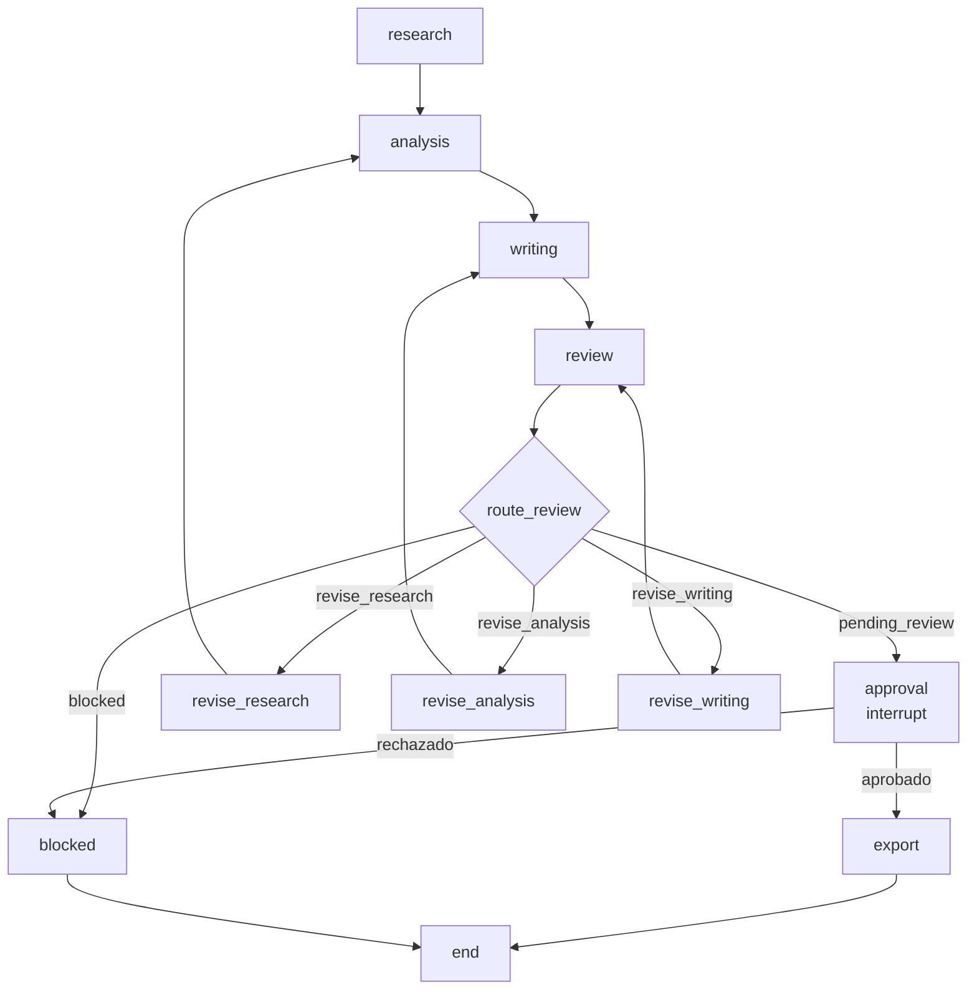

# Flujo LangGraph

Responsable: **Isabella (Persona 5)**.

> **Estado: implementado (PR #30)**. `workflows.py`, `persistence.py`, `state.py` y `events.py` están activos; `langgraph-checkpoint-sqlite==3.1.2` está en `requirements.txt`. Falta el controlador humano y la interfaz web completa.

## Objetivo

Encadenar el flujo completo —investigación → análisis → redacción → revisión → aprobación humana → exportación— con un estado compartido, un límite de correcciones y una parada obligatoria antes de exportar.

## Estado propuesto

```python
class FitFamilyState(TypedDict, total=False):
    run_id: str
    brief: ResearchBrief
    research_result: ResearchResult
    competitor_data: pd.DataFrame        # adaptador pendiente
    analysis: dict
    draft: ReportDraft
    review: ReviewResult
    revision_count: int
    approval: ApprovalRecord | None
    export_paths: dict[str, str]
    error: str | None
```

El estado debe permitir reconstruir por qué se exportó un borrador: `run_id`, `draft_id`, `draft_version`, huella y decisión humana.

## Nodos

| Nodo | Función | Responsable |
|---|---|---|
| `research` | `run_research(brief)` | Juan |
| `analysis` | `summarize_competitors` + `calculate_break_even_clients` | Laura |
| `writing` | `build_report(brief, research_result, use_llm=...)` | Gema |
| `review` | `run_basic_review(draft, research_result)` | María |
| `route_review` | `choose_review_route_for_context(review, draft, research_result, revision_count)` | María |
| `revise_research` | Volver a investigar con las incidencias | Juan |
| `revise_analysis` | Recalcular el análisis | Laura |
| `revise_writing` | Regenerar el borrador | Gema |
| `approval` | Interrupción para decisión humana | Isabella |
| `export` | `export_markdown` / `export_pdf` | Gema |
| `blocked` | Terminar sin exportar | Isabella |

## Grafo



## Reglas de transición

1. **Máximo de correcciones.** `max_revisions=2`; al agotarse, `choose_review_route` devuelve `blocked` y no se exporta.
2. **Prioridad de etapa.** Si hay errores de investigación y de redacción, primero se corrige investigación (`revise_research`).
3. **Sin errores no significa aprobado.** `pending_review` solo habilita la parada humana; no autoriza la exportación.
4. **Aprobación obligatoria.** El nodo `approval` debe interrumpir el grafo y esperar una decisión externa (Streamlit o consola). No se puede saltar con una bandera de configuración.
5. **Huella del borrador.** La aprobación se valida contra `calculate_draft_fingerprint(draft)`; si el borrador cambió, se vuelve a revisar.
6. **Acciones explícitas.** El `ApprovalRecord` debe incluir las acciones autorizadas; el exportador rechaza cualquier acción no listada.
7. **Rechazo.** Si la persona rechaza, el grafo termina en `blocked` sin crear archivos.
8. **Revisión vigente.** `route_review` usa `choose_review_route_for_context`, que valida que la revisión corresponda al borrador y a la investigación actuales. Si detecta cambios, lanza `ValueError`; el flujo debe repetir `run_basic_review(draft, research_result)` antes de continuar hacia `approval`.

## Punto de integración con Streamlit

```text
Streamlit
   │  inicia run_id y brief
   ▼
LangGraph ──► research → analysis → writing → review
   │
   ├── ¿needs_revision? ──► mostrar incidencias y botón "corregir"
   │
   └── pending_review ──► pantalla de aprobación
                              │
                              ├── aprobar ──► export
                              └── rechazar ──► blocked
```

La UI de [streamlit-approval.md](streamlit-approval.md) es la que construye el `ApprovalRecord`; el grafo solo lo consume.

## Decisiones pendientes

- Añadir `langgraph` a `requirements.txt`.
- Elegir checkpointer: memoria, SQLite o el estado de sesión de Streamlit.
- Definir si `revise_*` vuelve al nodo anterior o reinicia desde `research`.
- Acordar con Juan el adaptador `ResearchResult → DataFrame` para el nodo `analysis`.
- Acordar con Gema si la ruta LLM (`use_llm=True`) es un parámetro del grafo o una elección de la UI.
- Definir la telemetría: LangSmith ya está configurado de forma básica en `.env.example`.
- Acordar con María, Laura y Gema cómo pasar `analysis` al revisor para validar cifras del informe (metric_id, value, unit).

## Criterios de aceptación

- [ ] El grafo se ejecuta de principio a fin con datos de prueba.
- [ ] `revision_count` nunca supera `max_revisions`.
- [ ] `blocked` no produce archivos.
- [ ] `approval` interrumpe realmente la ejecución.
- [ ] Una aprobación con huella distinta falla con `ValueError`.
- [ ] Se puede reanudar una ejecución aprobada sin repetir la investigación.
- [ ] Hay pruebas de las rutas `pending_review`, `revise_*`, `blocked` y `export`.

## Referencias

- [review-quality.md](review-quality.md) — `ReviewResult` y `choose_review_route`.
- [streamlit-approval.md](streamlit-approval.md) — contrato de la decisión humana.
- [report-export.md](report-export.md) — validación y publicación.
